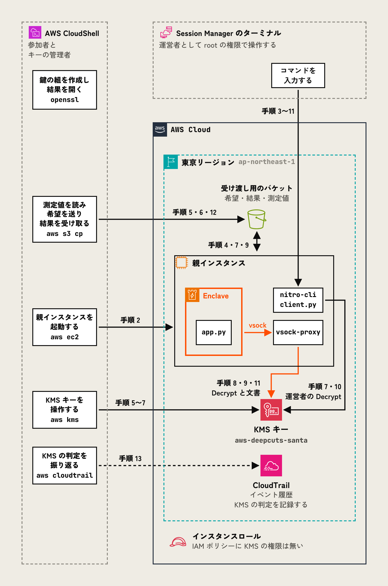
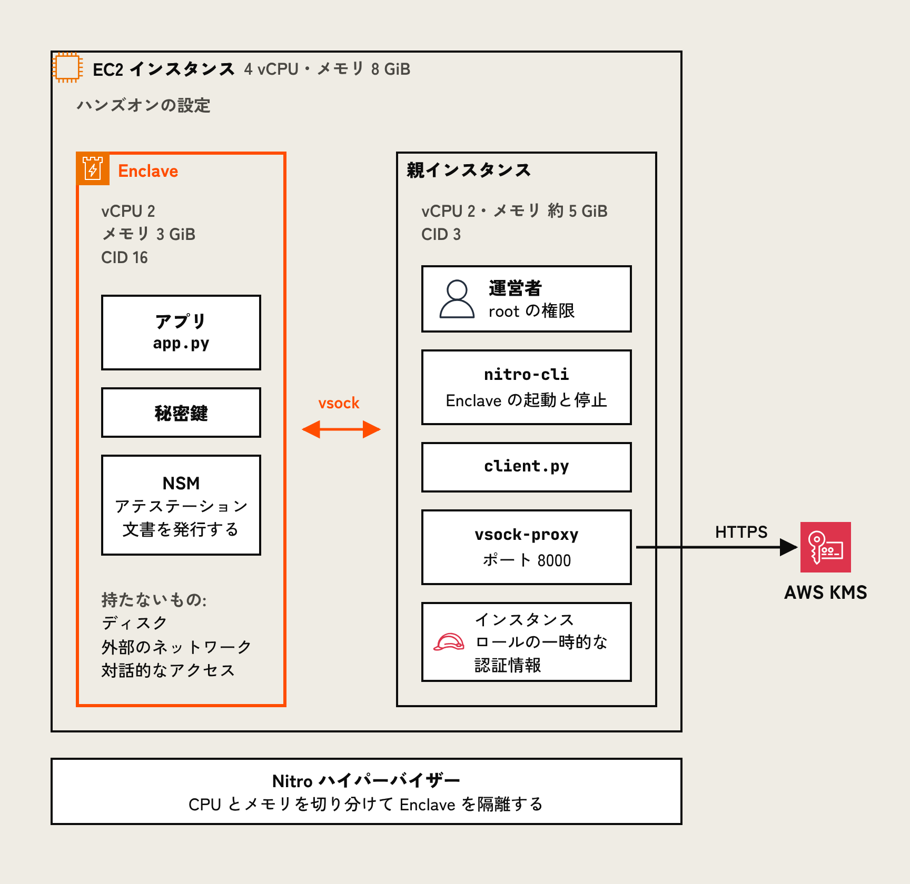
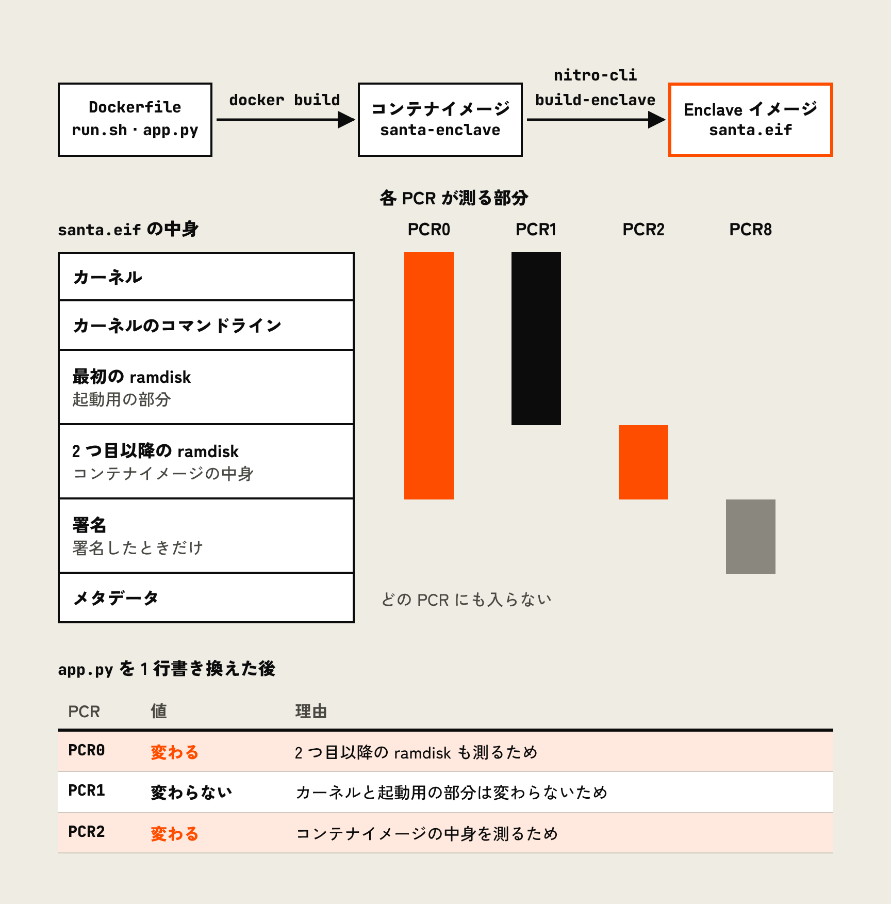
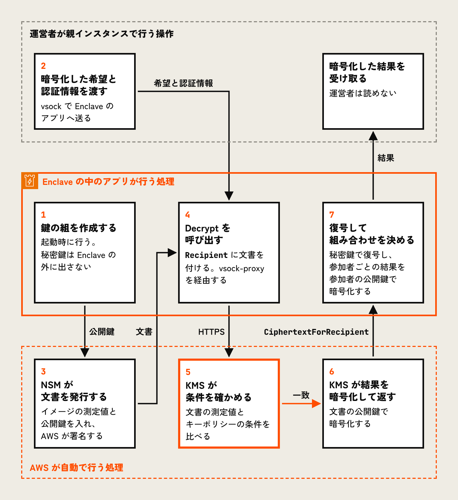
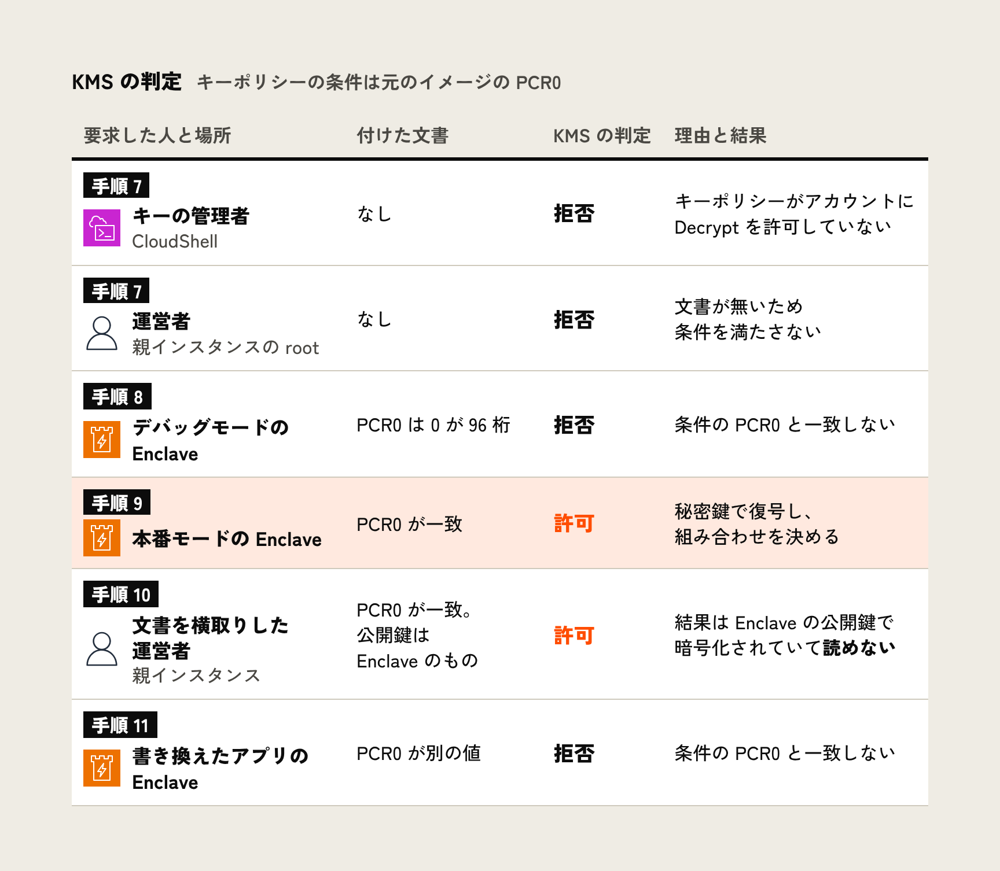

このリポジトリは AWS Deep Cuts の、AWS Nitro Enclaves に関するハンズオンコンテンツです。

<!-- TODO: 記事の公開後に、次の行のリンクを有効にする -->
<!-- AWS Nitro Enclaves の解説記事(Qiita)は[こちら]() -->

解説記事の原稿は [article/aws-nitro-enclaves.md](./article/aws-nitro-enclaves.md) にあります。

> **Note**: このハンズオンは、東京リージョン（`ap-northeast-1`）で実施します。AWS の告知によると、AWS Nitro Enclaves は 2025 年 10 月から全リージョンで使えます。<!-- 要確認: 告知の本文で確かめる -->事前準備の `setup.sh` は、東京リージョンで Nitro Enclaves に対応したインスタンスタイプがあることを AWS CLI で確かめてから、リソースを作成します。
> - 操作には 2 つの画面を使います。1 つは、ブラウザから AWS CLI のコマンドを実行できる AWS CloudShell です。もう 1 つは、Session Manager のターミナルです。Session Manager は AWS Systems Manager の機能で、ブラウザから EC2 インスタンスのシェルを使えます。
> - Enclave を動かす EC2 インスタンスの OS は、Amazon Linux 2023 です。

> ⚠️ **コストに関する注意**
>
> このハンズオンでは、EC2 インスタンスを 1 台起動し、その中に Enclave と呼ぶ隔離された VM（Virtual Machine）を作成します。Enclave を作成する元の EC2 インスタンスを、親インスタンスと呼びます。親インスタンスには、4 vCPU の EC2 インスタンスを使います。vCPU は、インスタンスに割り当てられた仮想の CPU です。親インスタンスは、初回の起動から 4 時間で自動で終了するように設定します。
>
> また、データの暗号化に、AWS KMS で作成する KMS キーを使います。KMS キーには、削除するまで 1 か月あたり 1 USD がかかります。
>
> | 状況 | 概算コストの上限 |
> | --- | --- |
> | 手順どおりに進め、後片付けをした場合 | 約 **$1.14**（約 180 円）。KMS キーの月額が時間で按分されない場合は約 **$1.91**（約 310 円） |
> | 後片付けを忘れた場合 | 親インスタンスは 4 時間で終了します。KMS キーには 1 か月あたり **$1** がかかり続けます。データの受け渡しに使う S3 バケットの保存料金は、1 か月あたり $0.03 未満です |
>
> 上限が成り立つ条件: 親インスタンスは、初回の起動から 4 時間で自動で終了します。インスタンスを再起動しても、終了の時刻は変わりません。親インスタンスで `shutdown -c` を実行したり、終了の時刻を延ばしたりすると、この上限は成り立ちません。
>
> 計算の前提と内訳は、[費用の見積もり](#費用の見積もり) にあります。前提は、親インスタンスを約 4 時間動かすこと、ルートボリュームが 30 GiB であること、KMS キーが 1 本であること、削除を待つ 7 日の間も KMS キーに課金されることの 4 つです。1 ドル 160 円で換算しています。**検証が終わったら速やかに後片付けを実施してください。**

# AWS Deep Cutsとは
AWS Deep Cutsは、AWS の最新のサービスやニッチな機能、または高度にアカデミックな知識を要求するサービスなど、多くの人が知らない 『隠れた名曲 = **Deep Cuts**』 を深くまで掘り下げる技術シリーズです。

このようなサービスはWeb情報も少なく、初学者は気軽にキャッチアップできないのが実情です。

そこで AWS Deep Cuts シリーズでは、**前提知識も含めた分かりやすいサービス解説** と **手順通りに進めれば誰でも再現できるハンズオン** を提供します！

# ハンズオンのゴール

このハンズオンでは、シークレットサンタの組み合わせを、サービスの運営者にも中身を見せずに決めます。シークレットサンタは、参加者がくじで贈る相手を決め、誰が誰に贈るかを秘密にしたまま贈り合う遊びです。参加者が欲しい物を書いたものを**希望**、誰が誰に贈るかを**組み合わせ**と呼びます。

組み合わせを決めるのは、EC2 インスタンスの中に作成した **Enclave** のアプリです。Enclave は、EC2 インスタンスの vCPU とメモリの一部を切り出して作成する、隔離された別の VM です。切り出す元の EC2 インスタンスを**親インスタンス**と呼びます。親インスタンスの OS の管理者の権限である root を持っていても、Enclave のメモリは読めません。

希望は、AWS KMS（AWS Key Management Service）で作成する **KMS キー**で暗号化します。KMS キーは、KMS の中から出ない暗号化のキーです。KMS キーごとに設定する、誰にどの操作を許可するかを定めた JSON を、**キーポリシー**と呼びます。Enclave は、自分がどのイメージから起動したかを、AWS の署名付きの文書で証明できます。この仕組みを**アテステーション**、その文書を**アテステーション文書**と呼びます。このハンズオンのキーポリシーは、決めたイメージから起動した Enclave のアテステーション文書を付けた要求にだけ、希望の復号を許可します。

Enclave のアプリは、誰に贈るかと、その相手の希望を書いた文を参加者ごとに作成します。この文を**結果**と呼びます。結果は、参加者の公開鍵で暗号化されます。公開鍵で暗号化したデータは、対になる秘密鍵でしか復号できないため、結果を読めるのは、その秘密鍵を持つ参加者だけです。公開鍵と、対になる秘密鍵を合わせて、**鍵の組**と呼びます。

実際のサービスでは、参加者・キーの管理者・運営者は別々の人です。このハンズオンでは、あなたが 3 つの役を 1 人で演じます。**運営者**は、シークレットサンタのサービスを運営し、親インスタンスの root の権限を持つ人です。

| 役 | 使う画面 | できること | できないこと |
| --- | --- | --- | --- |
| 参加者 | CloudShell | 自分の鍵の組を作成し、希望を KMS キーで暗号化する。自分の結果を開く | 他の参加者の希望を読む |
| キーの管理者 | CloudShell | KMS キーを作成し、キーポリシーを決める | キーポリシーを書き換えずに希望を復号する。このキーポリシーでは、グラントも作成できない |
| 運営者 | Session Manager のターミナル | 親インスタンスの root の権限を持ち、親インスタンスに付けた IAM ロールの権限を使う。Enclave を起動・停止する | 希望と組み合わせを読む |

表のグラントは、キーポリシーを変えずに、特定の IAM ユーザーや IAM ロールに KMS キーの操作を許可する仕組みです。グラントを作成できると、キーポリシーを書き換えずに自分に復号を許可できます。そのため、このハンズオンのキーポリシーは、グラントの作成を許可していません。

あなたは、キーの管理者と運営者として、希望を読もうとする操作を 4 回試します。この README では、この操作を**のぞき見**と呼びます。4 回ののぞき見のどれでも希望を読めないことを確かめてから、参加者として自分の結果を開きます。手順を進めながら、次の特徴を自分の目で確かめます。表の Enclave イメージ・測定値・PCR0・デバッグモードは、手順 4 と手順 8 で説明します。

| 確かめる特徴 | 手順 |
| --- | --- |
| Enclave の CPU とメモリは、親インスタンスから切り出される | 3 |
| Enclave イメージの測定値は、イメージの中身から計算され、アプリを 1 行変えると変わる | 4・11 |
| KMS は、キーポリシーの条件に合うアテステーション文書を付けた要求にだけ、復号を許可する | 5・7・8・9・11 |
| KMS が比べるのは文書の PCR0 で、`describe-enclaves` が表示する PCR0 ではない。デバッグモードでは、2 つの値が食い違う | 8 |
| KMS は復号したデータを Enclave の公開鍵で暗号化して返すため、文書を横取りしても読めない | 10 |
| 運営者は、参加者の希望と組み合わせを読めない。キーの管理者も、キーポリシーを書き換えない限り読めない。このキーポリシーは、グラントの作成も許可していない。結果を読めるのは、参加者が自分の結果だけ | 7〜12 |
| CloudTrail に、許可された要求に付いていた文書の PCR0 が記録される。拒否された要求には記録されない。送ったのが Enclave か運営者かは、記録からは区別できない | 13 |
| 後片付けの後に残るのは、削除を待つ KMS キーだけ | 14 |

用語の意味と仕組みは、解説記事で説明しています。先に記事の「AWS Nitro Enclavesとは？」と「仕組み」を読んでおくと、各手順で何を確かめているのかが分かりやすくなります。

# ハンズオン手順

以降の手順は、ハンズオン用に用意した AWS アカウントで実施してください。

## 構築するアーキテクチャ



図の手順の番号は、この README の手順の番号です。左の点線の枠は、参加者とキーの管理者として操作する CloudShell です。右上の点線の枠は、運営者として操作する Session Manager のターミナルです。

- あなたは CloudShell から AWS CLI のコマンドを実行し、親インスタンスを起動します。親インスタンスでは、Enclave を使えるように設定します。
- あなたは運営者として、Session Manager のターミナルから親インスタンスに接続します。親インスタンスの中で、`nitro-cli` を使って Enclave イメージを作成し、Enclave を起動します。`nitro-cli` は、Enclave イメージの作成と、Enclave の起動・停止を行うコマンドです。Enclave のアプリには、`client.py` で要求を送ります。
- 親インスタンスと Enclave は、vsock だけでつながります。vsock は、親インスタンスとだけつながるローカルのソケットです。Enclave から KMS への通信は、親インスタンスの vsock-proxy が中継します。vsock-proxy は、許可リストにある宛先へだけ通信を転送するプログラムです。
- あなたはキーの管理者として、CloudShell で KMS キーを作成します。参加者として、CloudShell で希望を暗号化し、受け渡し用のバケットに保存します。受け渡し用のバケットは、CloudShell と親インスタンスの間で、希望・結果・測定値を受け渡す S3 バケットです。
- KMS は、Decrypt の要求ごとに判定を行い、その記録を CloudTrail に残します。あなたは手順 13 で、CloudTrail の記録を振り返ります。

## 前提条件

- AWS CloudShell を **東京リージョン** で開くこと
- ルートユーザーではなく、IAM ユーザーか IAM ロールでサインインしていること。IAM Identity Center のユーザーも使えます。ルートユーザーで実行すると、`setup.sh` が止まります。
- 東京リージョンに既定の VPC があり、パブリック IPv4 アドレスを自動で割り当てる既定のサブネットがあること。親インスタンスは、Session Manager と KMS への通信に、パブリック IPv4 アドレスを使います。インバウンドのポートは開けません。
- オンデマンドの標準インスタンスの vCPU のクォータが 4 以上あること。Service Quotas のコンソールで、「AWS のサービス」から「Amazon Elastic Compute Cloud (Amazon EC2)」を開き、「Running On-Demand Standard (A, C, D, H, I, M, R, T, Z) instances」の適用されたクォータ値を確認します。CloudShell では、次のコマンドで確認できます。

  ```bash
  aws service-quotas list-service-quotas --service-code ec2 --region ap-northeast-1 \
    --query "Quotas[?starts_with(QuotaName, 'Running On-Demand Standard')].[QuotaName,Value]" --output table
  ```

- 有料プランのアカウントであること。2025 年 7 月 15 日以降に作成したアカウントには、無料プランと有料プランがあります。無料プランで、Nitro Enclaves に対応したインスタンスタイプを起動できるかは確かめられていません。次のコマンドで `PAID` と表示されれば、有料プランです。

  ```bash
  aws freetier get-account-plan-state --region us-east-1 --query accountPlanType --output text
  ```

  アカウントによっては、プランの情報が無く、次のエラーになります。2026 年 11 月の検証に使ったアカウントでは、このエラーになりました。このアカウントでも、ハンズオンのすべての手順を実行できました。

  ```text
  aws: [ERROR]: An error occurred (ResourceNotFoundException) when calling the GetAccountPlanState operation: Missing data for account: 111122223333
  ```

  <!-- 要確認: 無料プランのアカウントで c6i.xlarge を起動できるか -->

- CloudShell を開いた IAM ユーザーまたは IAM ロールに、EC2・IAM・S3・KMS・Systems Manager・CloudTrail の操作権限があること。`AdministratorAccess` 相当の権限で実施するのが簡単です。

<details>
<summary>手順で使う API と、最小権限に近い IAM ポリシーの例</summary>

<!-- 要確認: IAM ポリシーシミュレーターで手順 1〜14 を確かめる。マネジメントコンソールの画面が追加で読み取りの権限を求めることがある -->

CloudShell の IAM ユーザーまたは IAM ロールが、各手順で使う API は次のとおりです。親インスタンスの中の操作は、親インスタンスに付ける IAM ロールの権限で行うため、この表には含めません。

| 手順 | 使う API | 補足 |
| --- | --- | --- |
| 前提条件 | `sts:GetCallerIdentity`、`freetier:GetAccountPlanState`、`servicequotas:ListServiceQuotas` | クォータは CLI で確かめる場合だけ |
| 1 の `setup.sh` | `ec2:DescribeVpcs`・`DescribeSubnets`・`DescribeInstanceTypes`・`DescribeInstanceTypeOfferings`・`DescribeSecurityGroups`・`CreateSecurityGroup`・`CreateTags`、`s3:CreateBucket`・`PutBucketPublicAccessBlock`・`PutObject`、`iam:CreateRole`・`TagRole`・`GetRole`・`AttachRolePolicy`・`PutRolePolicy`・`CreateInstanceProfile`・`TagInstanceProfile`・`GetInstanceProfile`・`AddRoleToInstanceProfile` | `iam:TagRole` は `create-role --tags` に、`iam:TagInstanceProfile` は `create-instance-profile --tags` に要る。同じ名前の既存のリソースのタグを読むため、`iam:GetRole`・`GetInstanceProfile`・`ec2:DescribeSecurityGroups` を使う |
| 1 の確かめること | `iam:ListRoles`・`GetRole`・`ListAttachedRolePolicies`・`ListRolePolicies`・`GetRolePolicy`・`GetPolicy`・`GetPolicyVersion` | IAM コンソールで確認するため |
| 2 | `ec2:RunInstances`・`CreateTags`・`DescribeInstances`・`DescribeInstanceTypes`、`iam:PassRole`、`ssm:GetParameters`、`ssm:DescribeInstanceInformation` | `iam:PassRole` は `aws-deepcuts-enclave-parent-role` だけ。`--image-id resolve:ssm:...` に `ssm:GetParameters` が要る |
| 3〜11 の Session Manager のコンソール | `ssm:StartSession`・`TerminateSession`・`ResumeSession`・`DescribeSessions`・`GetConnectionStatus`・`DescribeInstanceProperties`、`ec2:DescribeInstances` | EC2 コンソールの「接続」画面に要る |
| 5 | `s3:GetObject`、`kms:CreateKey`・`DescribeKey`・`TagResource`・`CreateAlias`・`GetKeyPolicy`・`PutKeyPolicy`・`ListKeys`・`ListAliases`・`ListResourceTags` | `create-key --tags` には `kms:TagResource` が要る。`PutKeyPolicy` は、作成した人が後でキーポリシーを変えられるかの確認に要る。`List*` は KMS コンソールの一覧に要る |
| 6 | `kms:Encrypt`・`DescribeKey`、`s3:PutObject`・`ListBucket`・`ListAllMyBuckets`・`GetBucketLocation` | 後の 2 つは S3 コンソールに要る |
| 7 | `kms:Decrypt` | 拒否されることを確かめるため |
| 12 | `s3:GetObject`・`ListBucket` | `cp --recursive` に `ListBucket` が要る |
| 13 | `cloudtrail:LookupEvents` | CloudTrail コンソールのイベント履歴も同じ |
| 14 の `cleanup.sh` と確認 | `ec2:DescribeInstances`・`TerminateInstances`・`DescribeSecurityGroups`・`DeleteSecurityGroup`、`tag:GetResources`、`kms:DescribeKey`・`ListResourceTags`・`DeleteAlias`・`ScheduleKeyDeletion`、`iam:RemoveRoleFromInstanceProfile`・`DeleteInstanceProfile`・`DetachRolePolicy`・`DeleteRolePolicy`・`DeleteRole`・`GetRole`・`GetInstanceProfile`、`s3:ListBucket`・`DeleteObject`・`DeleteBucket`・`ListAllMyBuckets` | `tag:GetResources` は、タグで KMS キーを探すため。`kms:ListResourceTags` は、キーにタグ `Project` が付いているかを確かめるため |

この表から組み立てた IAM ポリシーの例です。CloudShell を使う権限は、このポリシーとは別に必要です。たとえば、AWS 管理ポリシーの `AWSCloudShellFullAccess` をアタッチします。

```json
{
  "Version": "2012-10-17",
  "Statement": [
    {
      "Sid": "Ec2",
      "Effect": "Allow",
      "Action": [
        "ec2:DescribeVpcs", "ec2:DescribeSubnets", "ec2:DescribeInstanceTypes", "ec2:DescribeInstanceTypeOfferings",
        "ec2:DescribeSecurityGroups", "ec2:CreateSecurityGroup", "ec2:DeleteSecurityGroup", "ec2:CreateTags",
        "ec2:RunInstances", "ec2:DescribeInstances", "ec2:TerminateInstances"
      ],
      "Resource": "*"
    },
    {
      "Sid": "ParentRole",
      "Effect": "Allow",
      "Action": [
        "iam:CreateRole", "iam:TagRole", "iam:GetRole", "iam:AttachRolePolicy", "iam:DetachRolePolicy",
        "iam:PutRolePolicy", "iam:DeleteRolePolicy", "iam:DeleteRole", "iam:PassRole",
        "iam:ListAttachedRolePolicies", "iam:ListRolePolicies", "iam:GetRolePolicy",
        "iam:CreateInstanceProfile", "iam:TagInstanceProfile", "iam:GetInstanceProfile", "iam:AddRoleToInstanceProfile",
        "iam:RemoveRoleFromInstanceProfile", "iam:DeleteInstanceProfile"
      ],
      "Resource": [
        "arn:aws:iam::*:role/aws-deepcuts-enclave-parent-role",
        "arn:aws:iam::*:instance-profile/aws-deepcuts-enclave-parent-role"
      ]
    },
    {
      "Sid": "HandoffBucket",
      "Effect": "Allow",
      "Action": [
        "s3:CreateBucket", "s3:PutBucketPublicAccessBlock", "s3:PutObject", "s3:GetObject",
        "s3:ListBucket", "s3:DeleteObject", "s3:DeleteBucket"
      ],
      "Resource": ["arn:aws:s3:::aws-deepcuts-enclave-*", "arn:aws:s3:::aws-deepcuts-enclave-*/*"]
    },
    {
      "Sid": "Kms",
      "Effect": "Allow",
      "Action": [
        "kms:CreateKey", "kms:DescribeKey", "kms:TagResource", "kms:CreateAlias", "kms:GetKeyPolicy",
        "kms:PutKeyPolicy", "kms:ListKeys", "kms:ListAliases", "kms:ListResourceTags",
        "kms:Encrypt", "kms:Decrypt", "kms:DeleteAlias", "kms:ScheduleKeyDeletion"
      ],
      "Resource": "*"
    },
    {
      "Sid": "SessionManager",
      "Effect": "Allow",
      "Action": [
        "ssm:GetParameters", "ssm:DescribeInstanceInformation", "ssm:StartSession", "ssm:TerminateSession",
        "ssm:ResumeSession", "ssm:DescribeSessions", "ssm:GetConnectionStatus", "ssm:DescribeInstanceProperties"
      ],
      "Resource": "*"
    },
    {
      "Sid": "ReadOnly",
      "Effect": "Allow",
      "Action": [
        "sts:GetCallerIdentity", "freetier:GetAccountPlanState", "servicequotas:ListServiceQuotas",
        "iam:ListRoles", "iam:GetPolicy", "iam:GetPolicyVersion",
        "s3:ListAllMyBuckets", "s3:GetBucketLocation",
        "cloudtrail:LookupEvents", "tag:GetResources"
      ],
      "Resource": "*"
    }
  ]
}
```

`Kms` のステートメントに `kms:Decrypt` を含めているのは、手順 7 ののぞき見 1 で、「IAM ポリシーで許可されていても、キーポリシーが許可していなければ拒否される」ことを確かめるためです。KMS の操作のうち、`CreateKey`・`ListKeys`・`ListAliases` 以外は、手順 5 のキーポリシーの許可と、この IAM ポリシーの許可の両方がそろって初めて使えます。
</details>

以降、手順の冒頭に、使う画面と、誰として操作するかを書きます。

## １．事前準備

この手順は、CloudShell で行います。

このハンズオンでは、受け渡し用のバケット、親インスタンスに付けるインスタンスロール、親インスタンスのセキュリティグループを使います。これらのリソースの作成はハンズオンの本質ではないため、`setup.sh` で作成します。

```bash
# このリポジトリをクローン
git clone https://github.com/AWS-Deep-Cuts/aws-nitro-enclaves
cd aws-nitro-enclaves/hands-on

# セットアップスクリプトの実行
bash ./setup.sh

# 以下の文言が表示されればセットアップ成功です
# ✅ セットアップが完了しました！
```

`setup.sh` は、候補の c6i.xlarge・c5.xlarge・c6a.xlarge のうち、Nitro Enclaves に対応し、パブリック IPv4 アドレスを自動で割り当てる既定のサブネットがある AZ で提供されている最初のタイプを選びます。2026 年 11 月の検証では、東京リージョンで c6i.xlarge が選ばれ、`setup.sh` は約 40 秒で終わりました。

`setup.sh` は、次のリソースとファイルを作成します。

| リソース | 名前 | 用途 |
| --- | --- | --- |
| S3 バケット | `aws-deepcuts-enclave-<アカウント ID>-<日時>` | 受け渡し用のバケット。パブリックアクセスをすべてブロックする。`setup.sh` が、Enclave のアプリと補助のプログラムを `app/` にアップロードする |
| IAM ロールとインスタンスプロファイル | `aws-deepcuts-enclave-parent-role` | インスタンスロール。AWS 管理ポリシー `AmazonSSMManagedInstanceCore` と、受け渡し用のバケットの読み書きだけを許可するインラインポリシー `aws-deepcuts-enclave-bucket` を付ける。KMS の権限は付けない |
| セキュリティグループ | `aws-deepcuts-enclave-sg` | 親インスタンスのセキュリティグループ。インバウンドのルールを持たない |
| ファイル | `user-data.sh` | 親インスタンスのユーザーデータ。`user-data.sh.tpl` に、受け渡し用のバケットの名前とリージョンを埋めて作成する |

インスタンスロールは、親インスタンスに付ける IAM ロールです。インスタンスの中のプログラムは、このロールの権限で AWS の API を呼び出します。インスタンスプロファイルは、EC2 インスタンスに IAM ロールを付けるときに指定するリソースで、ロールと同じ名前で作成します。ユーザーデータは、EC2 インスタンスの初回の起動時に実行されるスクリプトです。このハンズオンのユーザーデータは、次の 3 つを行います。

- 初回の起動から 4 時間後にインスタンスを終了する予約を行う。終了の時刻をファイルに保存し、インスタンスを再起動しても、起動のたびに同じ時刻へ予約し直す
- `nitro-cli` を含むパッケージ `aws-nitro-enclaves-cli` と、アテステーション文書の表示に使う Python のライブラリ `cbor2` をインストールする。Enclave イメージの作成に使う Docker も有効にする
- 受け渡し用のバケットの `app/` から、Enclave のアプリと補助のプログラムを `/root/santa` にダウンロードする。また、バケットの名前とリージョンを書いた `/root/santa/santa.env` を作成する

`setup.sh` は、作成したリソースの名前・ID・ARN を `resource-ids.env` に保存しました。ARN（Amazon Resource Name）は、AWS のリソースを一意に指す名前です。次のコマンドでこのファイルを読み込むと、以降のコマンドで変数として使えます。

```bash
source ./resource-ids.env
cat resource-ids.env
```

| 変数 | 中身 | 使う手順 |
| --- | --- | --- |
| `REGION` | リージョン `ap-northeast-1` | すべて |
| `ACCOUNT_ID` | AWS アカウントの ID | 5 |
| `SUBNET_ID` | 親インスタンスを起動するサブネットの ID | 2 |
| `INSTANCE_TYPE` | `setup.sh` が選んだインスタンスタイプ | 2 |
| `PROFILE_NAME` | インスタンスプロファイルの名前 | 2 |
| `ROLE_ARN` | インスタンスロールの ARN | 5 |
| `BUCKET_NAME` | 受け渡し用のバケットの名前 | 5・6・12 |
| `SG_ID` | セキュリティグループの ID | 2 |
| `KEY_ALIAS` | KMS キーのエイリアス `alias/aws-deepcuts-santa` | 5・6 |

`cat` の出力には、この表に無い `VPC_ID`・`AZ`・`ROLE_NAME` も表示されます。この 3 つは、`setup.sh` と `cleanup.sh` が使う値で、以降の手順のコマンドでは使いません。以降の手順でも、作成したリソースの ID を、このファイルに追記していきます。手順 2 で `INSTANCE_ID` を、手順 5 で `PCR0` と `KEY_ID` を追記します。

> **Note**: CloudShell は、操作しない時間が続くとセッションが終了し、変数が消えます。その場合は、次の 2 行を実行してから続きの手順に進んでください。
>
> ```bash
> cd ~/aws-nitro-enclaves/hands-on
> source ./resource-ids.env
> ```

<!-- 画面写真: IAM コンソールの aws-deepcuts-enclave-parent-role の「許可」タブ。2 つのポリシーを枠で囲み、KMS の権限が無いことが分かるようにする -->

> **この手順で確かめること**
> - **やること**: IAM コンソールの左のメニューから「ロール」を選び、`aws-deepcuts-enclave-parent-role` を開いて「許可」タブを確認します。インラインポリシーの行の左の「+」を押すと、ポリシーの JSON が開きます。
> - **期待する結果**: AWS 管理ポリシー `AmazonSSMManagedInstanceCore` と、インラインポリシー `aws-deepcuts-enclave-bucket` の 2 つが表示されます。インラインポリシーが許可しているのは、受け渡し用のバケットの読み書きだけです。KMS の権限はありません。
> - **ここから分かること**: 運営者が使うインスタンスロールには、IAM ポリシーで KMS の権限を与えていません。復号の許可は、手順 5 で、キーポリシーに条件を付けて与えます。

## ２．Enclave を使える親インスタンスを起動する

この手順は、CloudShell で行います。この手順で起動する EC2 インスタンスが、Enclave の親インスタンスになります。

### 2-1. インスタンスタイプを確かめる

`setup.sh` が選んだインスタンスタイプについて、Nitro Enclaves への対応と、vCPU の構成を表示します。

```bash
aws ec2 describe-instance-types --region "${REGION}" --instance-types "${INSTANCE_TYPE}" \
  --query 'InstanceTypes[0].{Type:InstanceType,vCPU:VCpuInfo.DefaultVCpus,Cores:VCpuInfo.DefaultCores,ThreadsPerCore:VCpuInfo.DefaultThreadsPerCore,NitroEnclaves:NitroEnclavesSupport}' \
  --output table
```

`NitroEnclaves` の列が `supported` であれば、このインスタンスタイプで Enclave を使えます。`vCPU` は 4、`Cores` は 2、`ThreadsPerCore` は 2 と表示されます。つまり、2 つの物理コアが、それぞれ 2 つのスレッドを持っています。

Enclave には、CPU を物理コアの単位で渡します。また、CPU 0 とその兄弟スレッドは、親インスタンスに残します。そのため、1 コアあたり 2 スレッドの Intel や AMD のインスタンスタイプでは、親インスタンスに 4 vCPU 以上が必要です。このハンズオンでは、2 vCPU を親インスタンスに残し、もう 1 つの物理コアの 2 vCPU を Enclave に渡します。

`--instance-types` に別のインスタンスタイプを指定して、結果を比べてもかまいません。たとえば `t3.xlarge` を指定すると、`NitroEnclaves` の列に `unsupported` と表示されます。t3.xlarge も 4 vCPU ですが、Enclave は使えません。

### 2-2. 親インスタンスを起動する

`run-instances` で、EC2 に親インスタンスの起動を依頼します。

```bash
INSTANCE_ID=$(aws ec2 run-instances \
  --region "${REGION}" \
  --image-id resolve:ssm:/aws/service/ami-amazon-linux-latest/al2023-ami-kernel-default-x86_64 \
  --instance-type "${INSTANCE_TYPE}" \
  --subnet-id "${SUBNET_ID}" \
  --security-group-ids "${SG_ID}" \
  --iam-instance-profile "Name=${PROFILE_NAME}" \
  --enclave-options Enabled=true \
  --metadata-options HttpTokens=required,HttpEndpoint=enabled \
  --block-device-mappings 'DeviceName=/dev/xvda,Ebs={VolumeSize=30,VolumeType=gp3,DeleteOnTermination=true}' \
  --instance-initiated-shutdown-behavior terminate \
  --user-data file://user-data.sh \
  --tag-specifications 'ResourceType=instance,Tags=[{Key=Name,Value=aws-deepcuts-enclave-parent},{Key=Project,Value=aws-deepcuts-nitro-enclaves}]' \
  --count 1 \
  --query 'Instances[0].InstanceId' --output text)

[[ -n "${INSTANCE_ID}" ]] && echo "INSTANCE_ID=\"${INSTANCE_ID}\"" >> resource-ids.env
echo "${INSTANCE_ID}"
```

コマンドが失敗した場合、`INSTANCE_ID` は空になり、`resource-ids.env` には何も追記されません。

| パラメータ | 指定した値 | 意味 |
| --- | --- | --- |
| `--image-id` | Amazon Linux 2023 の最新の AMI | AMI は、EC2 インスタンスの OS のイメージ。`resolve:ssm:` を付けると、EC2 が Systems Manager のパラメータから AMI の ID を取得する |
| `--instance-type` | `setup.sh` が選んだタイプ | 4 vCPU・メモリ 8 GiB |
| `--subnet-id`、`--security-group-ids` | `setup.sh` が選んだサブネットと、作成したセキュリティグループ | パブリック IPv4 アドレスを自動で割り当てる既定のサブネット。インバウンドのルールは無い |
| `--iam-instance-profile` | `aws-deepcuts-enclave-parent-role` | インスタンスロールを付ける |
| `--enclave-options` | `Enabled=true` | このインスタンスで Enclave を使えるようにする。インスタンスの起動時に決める設定で、休止と同時には有効にできない |
| `--metadata-options` | `HttpTokens=required` | IMDS の呼び出しにトークンを必須にする。IMDS（Instance Metadata Service）は、インスタンスの中のプログラムが、インスタンスの情報とインスタンスロールの一時的な認証情報を取得する仕組み |
| `--block-device-mappings` | 30 GiB の gp3 | ルートボリューム。手順 4 の `docker build` に使うディスクの容量を確保する。インスタンスの終了と同時に削除する |
| `--instance-initiated-shutdown-behavior` | `terminate` | インスタンスの中から停止したときに、インスタンスを終了する |
| `--user-data` | `user-data.sh` | 初回の起動時に実行するスクリプト。4 時間後の終了の予約と、パッケージのインストールを行う |
| `--tag-specifications` | `Name` と `Project` のタグ | `cleanup.sh` は、`Project` のタグでインスタンスを探して終了する |
| `--count` | 1 | 起動するインスタンスの数 |

`--user-data` と `--instance-initiated-shutdown-behavior` の組み合わせで、親インスタンスは初回の起動から 4 時間で自動で終了します。ユーザーデータが 4 時間後にインスタンスの中から停止を予約し、停止の動作が `terminate` であるため、停止はインスタンスの終了になります。

### 2-3. 起動を待って確かめる

次のコマンドは、インスタンスの状態が `running` になるまで待ちます。

```bash
aws ec2 wait instance-running --region "${REGION}" --instance-ids "${INSTANCE_ID}"
```

起動したインスタンスの状態と、Enclave の設定を表示します。

```bash
aws ec2 describe-instances --region "${REGION}" --instance-ids "${INSTANCE_ID}" \
  --query 'Reservations[0].Instances[0].{State:State.Name,Type:InstanceType,AZ:Placement.AvailabilityZone,NitroEnclaves:EnclaveOptions.Enabled}' \
  --output table
```

`State` は `running`、`NitroEnclaves` は `True` と表示されます。

次に、インスタンスの中の SSM エージェントが Systems Manager に登録されたかを確認します。SSM エージェントは、Session Manager の接続を受け付けるプログラムで、Amazon Linux 2023 の AMI に入っています。

```bash
aws ssm describe-instance-information --region "${REGION}" \
  --filters "Key=InstanceIds,Values=${INSTANCE_ID}" \
  --query 'InstanceInformationList[0].PingStatus' --output text
```

`Online` と表示されるまで、数分おきにこのコマンドを実行し直してください。`None` は、まだ登録されていないことを表します。2026 年 11 月の検証では、`run-instances` から 3 分以内に `Online` になりました。

<!-- 画面写真: EC2 コンソールのインスタンスの詳細。Nitro Enclave の項目を枠で囲む -->

> **この手順で確かめること**
> - **やること**: EC2 コンソールの左のメニューから「インスタンス」を選び、`aws-deepcuts-enclave-parent` を開いて、「詳細」タブの「インスタンスの詳細」で「Enclaves のサポート」の項目を確認します。
> - **期待する結果**: 「Enclaves のサポート」が「有効」です。CLI の `State` は `running`、`NitroEnclaves` の列は `True`、`PingStatus` は `Online` です。
> - **ここから分かること**: Enclave を使えるかどうかは、インスタンスの起動時に、EC2 の設定で決めます。この時点では、Enclave はまだ起動していません。Enclave を起動するのは EC2 の API ではなく、親インスタンスの中の `nitro-cli` です。

> **Note**: 親インスタンスは、初回の起動から 4 時間で自動で終了します。インスタンスを再起動しても、終了の時刻は変わりません。ユーザーデータが作成した systemd のユニット `aws-deepcuts-deadline.service` が、起動のたびに同じ時刻へ終了を予約し直すためです。ただし、予約は分の単位に切り上げるため、再起動の後は最大で 1 分遅れます。2026 年 11 月の検証では、再起動の前の予約が 22:10:42、再起動の後の予約が 22:11:33（UTC）でした。
>
> <!-- 要確認: 4 時間後に terminated になること -->
>
> 時間が足りないときは、Session Manager のターミナルで root として次の 2 行を実行し、終了の時刻を書き換えます。この例では、終了の時刻を今から 60 分後にします。延ばした分だけ費用が増えます。1 時間あたり約 0.22 USD です。
>
> ```bash
> date -u -d '+60 minutes' +%s > /var/lib/aws-deepcuts/deadline
> /usr/local/sbin/aws-deepcuts-deadline.sh
> ```
>
> `shutdown -c` は実行しないでください。`shutdown -c` を実行すると、そのインスタンスが次に起動するまで、自動の終了が働かなくなります。そのまま放置すると、1 日あたり最大で約 5.4 USD がかかります。内訳は、EC2 の 0.214 USD × 24 時間、パブリック IPv4 アドレスの 0.005 USD × 24 時間、30 GB の EBS の 1 日分です。
>
> 自動で終了した場合は、手順 2-2 からやり直します。手順 4 で受け渡し用のバケットに保存した Enclave イメージを使えば、測定値は変わりません。詳しくは手順 4 の Note を確認してください。親インスタンスを起動し直すたびに、費用は最大で約 0.89 USD 増えます。

## ３．親インスタンスで Enclave 用の CPU とメモリを確保する

この手順は、Session Manager のターミナルで、運営者として行います。

1 台の EC2 インスタンスが、親インスタンスと Enclave にどう分かれるのかは、次の図のとおりです。図の数値は、このハンズオンの設定です。



Enclave には、ディスク・外部のネットワーク・対話的なアクセスがありません。Enclave が外とやり取りする経路は、親インスタンスとの vsock だけです。vsock では、各 VM を CID と呼ぶ番号で区別します。親インスタンスの CID は 3、このハンズオンの Enclave の CID は 16 です。Enclave から KMS への通信は、親インスタンスの vsock-proxy が、ポート 8000 で受け取って KMS へ転送します。

### 3-1. 親インスタンスに接続する

EC2 コンソールの左のメニューから「インスタンス」を選び、`aws-deepcuts-enclave-parent` を選択して「接続」を押します。「ウェブブラウザで」タブの「接続方法を選択」で「SSM セッションマネージャー」を選び、「接続」を押します。ブラウザの新しいタブに、Session Manager のターミナルが開きます。

<!-- 画面写真: EC2 コンソールの「インスタンスに接続」の「ウェブブラウザで」タブ。「SSM セッションマネージャー」と「接続」ボタンを枠で囲む -->

ターミナルで、root の権限に切り替えます。以降、Session Manager のターミナルのコマンドは、すべて root として実行します。

```bash
sudo -i
```

ユーザーデータの処理が終わるまで待ちます。

```bash
cloud-init status --wait
```

`status: done` と表示されれば、ユーザーデータの処理が終わっています。`status: error` と表示された場合は、[トラブルシューティング](#トラブルシューティング)を確認してください。

ユーザーデータがダウンロードしたファイルを確認し、変数を読み込みます。

```bash
cd /root/santa && source ./santa.env && ls -R
```

`santa.env` には、`REGION`・`BUCKET_NAME`・`ENCLAVE_CID` の 3 つの変数が入っています。`ENCLAVE_CID` は、Enclave に割り当てる CID の 16 です。

インストールされたツールの版と、インスタンスが自動で終了する時刻を表示します。

```bash
nitro-cli --version
aws --version
date -d "@$(cat /var/lib/aws-deepcuts/deadline)"
```

`aws --version` は、2.11.17 以降であることを確認します。KMS の Decrypt にアテステーション文書を付ける `--recipient` のパラメータは、2023 年 5 月の AWS CLI 2.11.17 から使えます。2026 年 11 月の検証では、dnf で Nitro CLI 1.5.0 が入り、AMI の AWS CLI は 2.38.0 でした。最後の行は、初回の起動から 4 時間後の時刻を表示します。

> **Note**: Session Manager のセッションが切れたら、新しいセッションで次の 2 行を実行してから、続きの手順に進んでください。
>
> ```bash
> sudo -i
> cd /root/santa && source ./santa.env
> ```

### 3-2. CPU とメモリを確保する

Enclave に渡す CPU とメモリは、親インスタンスの中のアロケーターが、Enclave の起動の前に確保します。アロケーターは、systemd のサービス `nitro-enclaves-allocator.service` として動き、設定ファイル `/etc/nitro_enclaves/allocator.yaml` の値に従って確保します。

確保する前の vCPU の数を表示します。

```bash
nproc
```

`4` と表示されます。これは、親インスタンスの OS が使える vCPU の数です。

アロケーターの設定ファイルを表示します。

```bash
cat /etc/nitro_enclaves/allocator.yaml
```

既定の値は、`memory_mib: 512` と `cpu_count: 2` です。このハンズオンの Enclave には、3,072 MiB のメモリを渡します。メモリの値を書き換えます。

```bash
sed -i 's/^memory_mib:.*/memory_mib: 3072/' /etc/nitro_enclaves/allocator.yaml
grep -E '^(memory_mib|cpu_count):' /etc/nitro_enclaves/allocator.yaml
```

`memory_mib: 3072` と `cpu_count: 2` と表示されます。アロケーターを起動し、インスタンスの起動時にも自動で起動するように設定します。

```bash
systemctl enable --now nitro-enclaves-allocator.service
```

確保した後の vCPU の数と、CPU の状態を表示します。

```bash
nproc
lscpu | grep -E '^(On|Off)-line'
```

`lscpu` の `On-line CPU(s) list` は親インスタンスが使える CPU の番号、`Off-line CPU(s) list` は Enclave 用に切り出した CPU の番号です。

Enclave 用に確保したメモリを表示します。

```bash
grep -H . /sys/kernel/mm/hugepages/hugepages-*/nr_hugepages
```

アロケーターは、物理的に連続したメモリの領域を、ヒュージページの単位で確保します。ヒュージページは、2 MiB か 1 GiB の大きなページです。出力のファイル名の `hugepages-2048kB` は 2 MiB のページ、`hugepages-1048576kB` は 1 GiB のページを表し、行の最後の数がページの数です。たとえば `hugepages-1048576kB/nr_hugepages:3` は、1 GiB × 3 で 3,072 MiB を確保したことを表します。2026 年 11 月の検証（c6i.xlarge）では、1 GiB のページで確保され、2 MiB のページの数は 0 でした。

### 3-3. vsock-proxy を起動する

Enclave から KMS への通信を中継する vsock-proxy を起動します。

```bash
systemctl enable --now nitro-enclaves-vsock-proxy.service
systemctl status nitro-enclaves-vsock-proxy.service --no-pager | head -n 12
```

このサービスは、IMDS からインスタンスのリージョンを取得し、`vsock-proxy 8000 kms.<リージョン>.amazonaws.com 443` のコマンドで vsock-proxy を起動します。vsock のポート 8000 で受け取った通信を、そのリージョンの KMS のポート 443 へ転送します。

`systemctl status` の出力には、`Drop-In:` の 2 行と、`ExecStartPost` の `Process:` の行も表示されます。このサービスは、bash が IMDS からリージョンを取得した後に vsock-proxy に置き換わります。ユーザーデータは、その置き換わりを `systemctl enable --now` が待つ設定を追加しています。そのため、直後の `systemctl status` の `Main PID` は `vsock-proxy` になります。

vsock-proxy が転送できる宛先は、許可リスト `/etc/nitro_enclaves/vsock-proxy.yaml` に書かれた宛先だけです。東京リージョンの KMS が許可リストにあることを確認します。

```bash
grep 'ap-northeast-1' /etc/nitro_enclaves/vsock-proxy.yaml
```

<!-- 画面写真: Session Manager のターミナル。2 回の nproc の結果と、lscpu の Off-line の行を枠で囲む -->

> **この手順で確かめること**
> - **やること**: 2 回の `nproc` の結果、`lscpu` の `On-line` と `Off-line` の行、ヒュージページの数を比べます。`systemctl status` の出力で、vsock-proxy の状態の行と、起動したコマンドの行を読みます。
> - **期待する結果**: `nproc` の結果は 4 から 2 に減ります。`Off-line` の CPU の番号に、0 は含まれません。ヒュージページの数とページの大きさを掛けて足すと、合計 3,072 MiB になります。2026 年 11 月の検証では、1 GiB のページが 3 つでした。2 MiB と 1 GiB のどちらのページで確保されるかは、環境によって異なる可能性があるため、観察してください。vsock-proxy の状態は `active (running)` で、起動したコマンドに `8000 kms.ap-northeast-1.amazonaws.com 443` が含まれます。`grep` は、`kms.ap-northeast-1.amazonaws.com` の行を表示します。
> - **ここから分かること**: Enclave の CPU とメモリは、親インスタンスから切り出されます。切り出した CPU は、親インスタンスの OS から見えなくなります。CPU 0 は親インスタンスに残ります。Enclave から KMS への唯一の経路は親インスタンスの vsock-proxy で、転送先は許可リストで限られています。

## ４．Enclave イメージを作成して測定値を確かめる

この手順は、Session Manager のターミナルで、運営者として行います。

Enclave は、Enclave イメージから起動します。Enclave イメージは、Enclave の中で動くアプリと OS をまとめたファイルで、形式の名前から EIF（Enclave Image File）とも呼ばれます。Enclave イメージは、次の 2 段階で作成します。

1. Docker で、Dockerfile からコンテナイメージを作成する。Docker は、アプリと必要なファイルをコンテナイメージにまとめ、実行するツールです。
2. `nitro-cli build-enclave` で、コンテナイメージから Enclave イメージを作成する。

このハンズオンには、名前に「イメージ」が付くものが 3 つ出てきます。以降、単に「イメージ」と書くときは、Enclave イメージを指します。

| イメージ | 何か | 誰が用意するか |
| --- | --- | --- |
| AMI | 親インスタンスの OS のイメージ。Amazon Linux 2023 | AWS が用意している |
| コンテナイメージ `santa-enclave:latest` | Dockerfile から作成するイメージ | あなたが `docker build` で作成する |
| Enclave イメージ `santa.eif` | Enclave の起動に使うファイル | あなたが `nitro-cli build-enclave` で作成する |

### 4-1. アプリを読む

Enclave イメージに入れるファイルを、1 つずつ確認します。

```bash
cat enclave/Dockerfile
```

Dockerfile は 2 段階に分かれています。段階 1 では、AWS が公開している NSM のライブラリ `libnsm.so` を、ソースからビルドします。NSM（Nitro Secure Module）は、Enclave の中から使える、AWS Nitro システムの部品で、アテステーション文書を発行します。段階 2 では、Python・boto3・OpenSSL を入れたコンテナイメージに、段階 1 の `libnsm.so` と、アプリの `run.sh`・`app.py` をコピーします。boto3 は、AWS SDK for Python です。boto3 1.42.97 は、Python 3.9 のサポートを 2026 年 4 月 29 日に終えたことを知らせる `PythonDeprecationWarning` を出します。動作には影響しないため、`ENV PYTHONWARNINGS` で、この警告だけを抑えています。

```bash
cat enclave/run.sh
```

`run.sh` は、Enclave の起動時に最初に実行されるスクリプトです。Enclave にはネットワークが無いため、ループバックのアドレス 127.0.0.1 を有効にし、KMS のホスト名 `kms.ap-northeast-1.amazonaws.com` を 127.0.0.1 に向けます。その後、`app.py` を起動します。

```bash
grep -n 'SHOW_WISHES_TO_OPERATOR\|^def ' enclave/app.py
```

`app.py` の関数の一覧と、`SHOW_WISHES_TO_OPERATOR` を含む行が表示されます。`SHOW_WISHES_TO_OPERATOR` は、手順 11 ののぞき見 4 で使うために用意した設定です。値が `True` のとき、アプリは、復号した希望を運営者への応答に含めます。元の値は `False` です。

`app.py` は、起動すると次の順に処理を行います。各段で 1 行のログを出力します。ログを親インスタンスから読めるのは、手順 8 で説明するデバッグモードのときだけです。

| 段 | 起動時の処理 |
| --- | --- |
| 1 | 設定 `SHOW_WISHES_TO_OPERATOR` の値をログに出力する |
| 2 | 127.0.0.1 のポート 443 に届いた通信を、vsock で親インスタンスの vsock-proxy に転送する処理を開始する。CID は 3、ポートは 8000 |
| 3 | `libnsm.so` を読み込み、NSM のデバイス `/dev/nsm` を開く |
| 4 | NSM に、この Enclave の PCR0 を問い合わせてログに出力する。PCR0 は、手順 4-2 で説明する |
| 5 | RSA 2048 ビットの鍵の組を作成する。秘密鍵は Enclave の外に出さない |
| 6 | vsock のポート 5000 で、親インスタンスからの要求を待ち受ける |

アプリが受け付ける要求は、次の 2 つです。

| 要求 | 要求の中身 | アプリの処理と応答 |
| --- | --- | --- |
| `attest` | なし | NSM に公開鍵を渡してアテステーション文書を受け取り、そのまま返す |
| `match` | 暗号化した希望と、インスタンスロールの一時的な認証情報 | 暗号化した希望ごとに KMS に Decrypt を依頼し、返ってきた `CiphertextForRecipient` を Enclave の秘密鍵で復号して、希望を取り出す。組み合わせを決め、参加者ごとの結果を、その参加者の公開鍵で暗号化して返す。最初の拒否で処理を止め、KMS のエラーコードを返す |

`match` の結果は、「`<受け取る人>` さんに贈ります。`<受け取る人>` さんの希望: `<希望>`」の形の文です。アプリは、参加者全員を無作為に並べ替え、各参加者が次の参加者に贈るように組み合わせを決めます。最後の参加者は最初の参加者に贈ります。参加者は 3 人以上で、各参加者が贈る相手は並び順で自分とは別の人になるため、自分に贈る人はいません。アプリのログには件数と成否だけを出力し、希望と組み合わせは出力しません。

このハンズオンの中心は、KMS に Decrypt を依頼する関数 `decrypt_wish()` です。

```bash
sed -n '/^def decrypt_wish/,/^def /p' enclave/app.py
```

最後の 1 行は、次の関数の先頭の行です。`decrypt_wish()` の本体は次のとおりです。

```python
def decrypt_wish(kms, blob, doc):
    """KMS に Decrypt を依頼し、返ってきた CiphertextForRecipient を Enclave の秘密鍵で復号する"""
    resp = kms.decrypt(
        CiphertextBlob=blob,
        Recipient={
            "KeyEncryptionAlgorithm": "RSAES_OAEP_SHA_256",
            "AttestationDocument": doc,  # NSM が発行した文書。PCR0 と Enclave の公開鍵が入っている
        },
    )
    # Plaintext は返らない。KMS は、復号した希望を文書の公開鍵で暗号化して返す
    envelope = resp["CiphertextForRecipient"]
    with tempfile.NamedTemporaryFile(dir="/tmp", suffix=".der") as f:
        f.write(envelope)
        f.flush()
        out = subprocess.run(
            ["openssl", "cms", "-decrypt", "-inform", "DER",
             "-inkey", "/tmp/enclave-key.pem", "-in", f.name],
            check=True, capture_output=True)
    return json.loads(out.stdout)
```

| 行 | 何が起きるか |
| --- | --- |
| `Recipient={…}` | アテステーション文書を Decrypt の要求に付ける。KMS は、文書の PCR0 をキーポリシーの条件と比べる |
| `resp["CiphertextForRecipient"]` | KMS は平文を返さず、復号した希望を文書の公開鍵で暗号化して返す |
| `openssl cms -decrypt … -inkey /tmp/enclave-key.pem` | Enclave の中にだけある秘密鍵で `CiphertextForRecipient` を復号し、希望を取り出す |

`Recipient` は、KMS の Decrypt にアテステーション文書を付けるためのパラメータです。`CiphertextForRecipient` は、KMS が復号したデータを、Enclave の公開鍵で暗号化した値です。この値は、CMS（Cryptographic Message Syntax）の EnvelopedData という形式のデータで、`openssl cms -decrypt` で復号できます。

最後に、運営者が実行する `client.py` が、Enclave に渡す認証情報をどこから取得しているかを確認します。

```bash
sed -n '/^def instance_role_credentials/,/^def /p' client.py
```

Enclave は、手順 2 で説明した IMDS に届かないため、IAM の認証情報を持っていません。`instance_role_credentials()` は、IMDSv2 でトークンを取得し、インスタンスロールの名前を調べて、そのロールの一時的な認証情報を取得します。`client.py` は、この認証情報をそのまま Enclave に渡します。つまり、Enclave が KMS の呼び出しに使う認証情報は、運営者も持っています。それでも運営者が希望を復号できないことを、手順 7 と手順 10 で確かめます。

### 4-2. Enclave イメージを作成する

コンテナイメージを作成します。

```bash
docker build -t santa-enclave:latest enclave/
```

`docker build` は 1〜2 分かかります。Rust のツールチェーンをダウンロードして、NSM のライブラリをビルドするためです。この間も、親インスタンスの料金はかかります。2026 年 11 月の検証では、`docker build` は約 1 分 20 秒で終わり、ルートボリュームの使用量は約 1.4 GB 増えました（2.2 GB から 3.6 GB）。

コンテナイメージから、Enclave イメージを作成します。

```bash
nitro-cli build-enclave --docker-uri santa-enclave:latest --output-file santa.eif | tee build-output.json
```

`build-enclave` は、作成の進み具合を標準エラー出力に、測定値の JSON を標準出力に出力します。`tee` は、標準出力の JSON を `build-output.json` に保存しながら画面にも表示します。出力の形の例は次のとおりです。値は、イメージの中身によって異なります。

```json
{
  "Measurements": {
    "HashAlgorithm": "Sha512_48 { .. }",
    "PCR0": "…（96 桁の 16 進）",
    "PCR1": "…",
    "PCR2": "…"
  }
}
```

**測定値**は、Enclave イメージの中身から計算した SHA-384 のハッシュ値です。`nitro-cli` は、イメージの部分ごとにハッシュ値を計算し、PCR と呼ぶ番号付きの欄に記録します。中身が 1 バイトでも違えば、値が変わります。ramdisk は、メモリの上に展開して使うファイルシステムのデータです。`HashAlgorithm` の `Sha512_48` は、SHA-512 と同じ計算で 48 バイト（384 ビット）の値を出す SHA-384 を表します。`nitro-cli` は、内部の型の名前をそのまま表示します。

| PCR | 測る対象 | 変わるとき |
| --- | --- | --- |
| PCR0 | カーネル・カーネルのコマンドライン・すべての ramdisk | イメージの中身が変わったとき |
| PCR1 | カーネル・カーネルのコマンドライン・最初の ramdisk | 起動用の部分が変わったとき |
| PCR2 | 2 つ目以降の ramdisk。コンテナイメージの中身 | アプリやライブラリが変わったとき |
| PCR8 | 署名に使った証明書 | 署名したイメージだけに値が入る |



このハンズオンでは、イメージに署名しないため、`build-enclave` が表示するのは PCR0・PCR1・PCR2 の 3 つです。

### 4-3. 大きさと中身を確かめる

Enclave イメージの大きさを、MiB の単位で表示します。

```bash
ls -l --block-size=M santa.eif
```

Enclave イメージの情報を表示します。

```bash
nitro-cli describe-eif --eif-path santa.eif
```

`describe-eif` は、Enclave イメージのファイルから、測定値や署名の有無などの情報を読み取って表示します。表示される PCR0 は、`build-output.json` の PCR0 と同じです。署名の有無を表す `IsSigned` は `false` です。続く `Metadata` には、元のコンテナイメージの情報が長く表示されます。

### 4-4. 測定値と Enclave イメージを受け渡し用のバケットに保存する

キーの管理者は、手順 5 で、この PCR0 をキーポリシーに書きます。測定値の JSON を、受け渡し用のバケットに保存します。

```bash
aws s3 cp build-output.json "s3://${BUCKET_NAME}/measurements/build-output.json" --region "${REGION}"
```

親インスタンスが自動で終了した場合に備えて、Enclave イメージも保存します。

```bash
aws s3 cp santa.eif "s3://${BUCKET_NAME}/eif/santa.eif" --region "${REGION}"
```

> **Note**: 親インスタンスが自動で終了し、手順 2-2 から起動し直した場合は、次のようにします。
>
> 1. 手順 3 をやり直します。アロケーターと vsock-proxy の設定は、新しいインスタンスにはありません。
> 2. `docker build` をやり直さず、受け渡し用のバケットから、同じ Enclave イメージと測定値を取得します。`build-output.json` は、手順 8・10・11 で PCR を比べるときに使います。`docker build` をやり直すと、PCR0 が変わることがあります。PCR0 が変わった場合は、キーの管理者が、手順 5 のキーポリシーを `put-key-policy` で更新します。手順は[トラブルシューティング](#トラブルシューティング)にあります。
>
>    ```bash
>    aws s3 cp "s3://${BUCKET_NAME}/eif/santa.eif" . --region "${REGION}"
>    aws s3 cp "s3://${BUCKET_NAME}/measurements/build-output.json" . --region "${REGION}"
>    ```
>
> 3. 手順 7 を終えていた場合は、暗号化した希望を新しいインスタンスに取得し直すため、手順 7-2 の `aws s3 cp "s3://${BUCKET_NAME}/inbox/" inbox/ --recursive --region "${REGION}"` を実行します。
> 4. 新しいインスタンスには Docker のキャッシュが無いため、手順 11 の `docker build` は、Rust のツールチェーンと NSM のライブラリのビルドからやり直しになり、手順 4 と同じく 1〜2 分かかります。

<!-- 画面写真: Session Manager のターミナル。build-enclave の出力の PCR0・PCR1・PCR2 を枠で囲む -->

> **この手順で確かめること**
> - **やること**: `build-output.json` の PCR0 の桁数を、`jq -r .Measurements.PCR0 build-output.json | tr -d '\n' | wc -c` で数えます。`santa.eif` の大きさを 4 倍して、Enclave に渡すメモリの 3,072 MiB と比べます。
> - **期待する結果**: PCR0 は 96 桁の 16 進数です。`santa.eif` の大きさの 4 倍は、3,072 MiB 以下です。2026 年 11 月の検証では、`santa.eif` は 199 MiB で、その 4 倍の 796 MiB は 3,072 MiB 以下でした。
> - **ここから分かること**: 測定値は、イメージの中身から計算した SHA-384 のハッシュ値で、インスタンスや起動の時刻には依存しません。次の手順で、キーの管理者がこの PCR0 をキーポリシーに書きます。また、`nitro-cli` は、Enclave に渡すメモリが Enclave イメージのファイルの大きさの 4 倍以上あるかを検査します。そのため、イメージが大きいほど、Enclave に多くのメモリが必要になります。

## ５．Enclave にだけ復号を許す KMS キーを作成する

この手順は、CloudShell で、キーの管理者として行います。

### 5-1. PCR0 を取得してキーポリシーを作成する

CloudShell のセッションが切れている場合に備えて、変数を読み込み直します。手順 4 で保存した測定値から PCR0 を取り出し、`resource-ids.env` に追記します。

```bash
cd ~/aws-nitro-enclaves/hands-on && source ./resource-ids.env
PCR0=$(aws s3 cp "s3://${BUCKET_NAME}/measurements/build-output.json" - --region "${REGION}" | jq -r '.Measurements.PCR0')
echo "${PCR0}"
[[ ${#PCR0} -eq 96 ]] && echo "PCR0=\"${PCR0}\"" >> resource-ids.env
```

96 桁の 16 進数が表示されれば成功です。96 桁のときだけ、`resource-ids.env` に追記されます。

次のコマンドで、キーポリシー `key-policy.json` を作成します。`${ACCOUNT_ID}`・`${ROLE_ARN}`・`${PCR0}` には、変数の値が入ります。最後の行は、3 つの変数が空でないかを確かめ、`OK` か `NG` を表示します。

```bash
cat > key-policy.json <<EOF
{
  "Version": "2012-10-17",
  "Statement": [
    {
      "Sid": "AllowKeyAdministration",
      "Effect": "Allow",
      "Principal": { "AWS": "arn:aws:iam::${ACCOUNT_ID}:root" },
      "Action": [
        "kms:CreateAlias", "kms:Describe*", "kms:Enable*", "kms:List*", "kms:Put*",
        "kms:Update*", "kms:Revoke*", "kms:Disable*", "kms:Get*", "kms:Delete*",
        "kms:TagResource", "kms:UntagResource", "kms:ScheduleKeyDeletion", "kms:CancelKeyDeletion"
      ],
      "Resource": "*"
    },
    {
      "Sid": "AllowEncryptForParticipants",
      "Effect": "Allow",
      "Principal": { "AWS": "arn:aws:iam::${ACCOUNT_ID}:root" },
      "Action": "kms:Encrypt",
      "Resource": "*"
    },
    {
      "Sid": "AllowDecryptOnlyFromEnclave",
      "Effect": "Allow",
      "Principal": { "AWS": "${ROLE_ARN}" },
      "Action": "kms:Decrypt",
      "Resource": "*",
      "Condition": {
        "StringEqualsIgnoreCase": {
          "kms:RecipientAttestation:ImageSha384": "${PCR0}"
        }
      }
    }
  ]
}
EOF
jq . key-policy.json
[[ ${#PCR0} -eq 96 && -n "${ROLE_ARN}" && -n "${ACCOUNT_ID}" ]] && echo "OK: 変数がすべて入っています" || echo "NG: 変数が空です。resource-ids.env を読み込み直してください"
```

キーポリシーは、1 つ以上の**ステートメント**からなります。ステートメントは、ポリシーの中の 1 つの規則です。`Principal` には、操作を許可する相手である**プリンシパル**を書きます。`Condition` には、許可する条件を書きます。条件に使う、要求の情報を表すキーを**条件キー**と呼びます。

| Sid | プリンシパル | 許可する操作 | 条件 |
| --- | --- | --- | --- |
| `AllowKeyAdministration` | アカウントを表すプリンシパル | エイリアスの作成、キーポリシーの変更、削除の予約などの管理の操作 | なし |
| `AllowEncryptForParticipants` | アカウントを表すプリンシパル | `kms:Encrypt` | なし |
| `AllowDecryptOnlyFromEnclave` | インスタンスロール `aws-deepcuts-enclave-parent-role` | `kms:Decrypt` | 要求に付いたアテステーション文書の PCR0 が、手順 4 の PCR0 と一致する |

`Sid`（Statement ID）は、ステートメントを区別するための名前です。`arn:aws:iam::<アカウント ID>:root` は、**アカウントを表すプリンシパル**です。このプリンシパルは、ルートユーザーのことではありません。キーポリシーでアカウントを表すプリンシパルに操作を許可すると、その操作は、IAM ポリシーで許可された同じアカウントの IAM ユーザーと IAM ロールも使えるようになります。そのため、CloudShell のあなたは、IAM ポリシーで許可されていれば、キーの管理と暗号化を行えます。一方、キーポリシーはアカウントを表すプリンシパルに Decrypt を許可していないため、IAM ポリシーで `kms:Decrypt` を許可されていても、あなたは復号できません。この点を、手順 7 で確かめます。

条件キー `kms:RecipientAttestation:ImageSha384` は、要求に付いたアテステーション文書の PCR0 を表します。比較の演算子 `StringEqualsIgnoreCase` は、大文字と小文字を区別せずに文字列を比べます。値は 96 桁の 16 進数で、`0x` を付けません。

管理の操作の一覧は、AWS 公式の kmstool のサンプルのキーポリシーを基にしました。公式の例は `kms:Create*` を許可しています。`kms:Create*` には CreateGrant が含まれ、グラントを作成できると、キーポリシーを書き換えずに自分に Decrypt を許可できます。そのため、このハンズオンでは `kms:CreateAlias` に絞りました。一方、`kms:Put*` には PutKeyPolicy が含まれます。つまり、キーの管理者は、キーポリシーを書き換えて、自分に復号を許可できます。キーの管理者への信頼は残る、ということです。

インスタンスロールの IAM ポリシーには、KMS の権限がありません。それでも、同じアカウントのロールにキーポリシーで直接許可すれば、そのロールは Decrypt を呼び出せます。インスタンスロールに Encrypt を許可していないのは、運営者が偽の希望を暗号化して紛れ込ませられないようにするためです。

### 5-2. 既にキーが無いことを確かめる

手順 5 をやり直すときに 2 本目のキーを作成しないように、エイリアスのキーが既にあるかを確かめます。

```bash
aws kms describe-key --region "${REGION}" --key-id "${KEY_ALIAS}" \
  --query 'KeyMetadata.[KeyId,KeyState]' --output text 2>/dev/null || echo "キーはまだありません"
```

- 「キーはまだありません」と表示された場合は、手順 5-3 に進みます。
- キー ID と `Enabled` が表示された場合は、そのキーがこのハンズオンで作成したキーかを、タグで確かめます。`<キー ID>` には、表示されたキー ID を入れます。

  ```bash
  aws kms list-resource-tags --region "${REGION}" --key-id "<キー ID>" \
    --query "Tags[?TagKey=='Project'].TagValue" --output text
  ```

  - `aws-deepcuts-nitro-enclaves` と表示された場合は、手順 5-3 は実行しません。次のコマンドで、表示されたキー ID を `KEY_ID` に設定して `resource-ids.env` に追記し、キーポリシーだけを更新します。PCR0 が変わった場合も、この方法で更新します。

    ```bash
    KEY_ID="<キー ID>"
    echo "KEY_ID=\"${KEY_ID}\"" >> resource-ids.env
    aws kms put-key-policy --region "${REGION}" --key-id "${KEY_ID}" --policy file://key-policy.json
    ```

  - 何も表示されない場合や、別の値が表示された場合は、エイリアス `alias/aws-deepcuts-santa` が、このハンズオンの外で作成されたキーを指しています。そのキーのキーポリシーを書き換えないでください。ここでハンズオンを止め、`bash ./cleanup.sh` で作成済みのリソースを削除してから、ハンズオン用の別のアカウントで実施してください。`cleanup.sh` は、タグの無いキーとそのエイリアスを削除しません。

### 5-3. KMS キーを作成してエイリアスを付ける

`create-key` で、KMS に KMS キーの作成を依頼します。キーポリシーには、手順 5-1 の `key-policy.json` を指定します。

```bash
KEY_ID=$(aws kms create-key --region "${REGION}" \
  --description "AWS Deep Cuts Nitro Enclaves secret santa" \
  --policy file://key-policy.json \
  --tags TagKey=Project,TagValue=aws-deepcuts-nitro-enclaves \
  --query KeyMetadata.KeyId --output text)

[[ -n "${KEY_ID}" ]] && echo "KEY_ID=\"${KEY_ID}\"" >> resource-ids.env
echo "${KEY_ID}"
```

| パラメータ | 指定した値 | 意味 |
| --- | --- | --- |
| `--description` | 説明文 | KMS コンソールに表示される説明 |
| `--policy` | `key-policy.json` | キーポリシー。指定しない場合は、アカウントを表すプリンシパルに `kms:*` を許可する既定のキーポリシーになる |
| `--tags` | `Project` のタグ | `cleanup.sh` は、このタグで KMS キーを探して削除を予約する。このパラメータを使うには、IAM ポリシーで `kms:TagResource` が許可されている必要がある |

KMS は、キーポリシーを受け付ける前に、作成を依頼したプリンシパル自身が、後でキーポリシーを変更できるかを確かめます。変更できないキーポリシーは、拒否されます。このキーポリシーでは、アカウントを表すプリンシパルに `kms:Put*` を許可しているため、IAM ポリシーで `kms:PutKeyPolicy` を許可されているあなたは、この確認を通ります。

キーに、エイリアス `alias/aws-deepcuts-santa` を付けます。エイリアスは、KMS キーに付ける別名です。このコマンドは、成功すると何も表示しません。

```bash
aws kms create-alias --region "${REGION}" --alias-name "${KEY_ALIAS}" --target-key-id "${KEY_ID}"
```

KMS に保存されたキーポリシーを表示します。

```bash
aws kms get-key-policy --region "${REGION}" --key-id "${KEY_ID}" --query Policy --output text | jq .
```

`cleanup.sh` は、エイリアスと `KEY_ID` だけでなく、タグ `Project=aws-deepcuts-nitro-enclaves` の付いたすべての KMS キーの削除を予約します。手順 5 を誤って 2 回実行しても、2 本目のキーは残りません。ただし、2 本目のキーにも削除を待つ間の料金がかかるため、KMS キーの費用は 2 倍になります。タグの無いキーは、削除の対象にしません。

<!-- 画面写真: KMS コンソールの aws-deepcuts-santa の「キーポリシー」タブ。Condition の ImageSha384 の行を枠で囲む -->

> **この手順で確かめること**
> - **やること**: KMS コンソールの左のメニューから「カスタマー管理型のキー」を選び、`aws-deepcuts-santa` を開いて「キーポリシー」タブを確認します。
> - **期待する結果**: ステートメントが 3 つあります。Decrypt を許可しているのは `aws-deepcuts-enclave-parent-role` だけで、その条件に `kms:RecipientAttestation:ImageSha384` と手順 4 の PCR0 があります。アカウントに `kms:*` や `kms:Create*` を与えるステートメントはありません。作成の操作は `kms:CreateAlias` だけです。
> - **ここから分かること**: このキーで暗号化したデータの復号を KMS が許可するのは、手順 4 のイメージの PCR0 が入ったアテステーション文書を付けた、インスタンスロールの要求だけです。キーポリシーは、`AdministratorAccess` を持つあなたにも、Decrypt とグラントの作成を許可していません。文書を付ければ誰の要求でも希望を読めるのか、という疑問は、手順 10 で確かめます。

## ６．参加者として希望を暗号化して送る

この手順は、CloudShell で、参加者として行います。4 人の参加者 `sato`・`suzuki`・`takahashi`・`tanaka` の役を、あなたが 1 人で演じます。

### 6-1. 参加者の鍵の組を作成する

参加者ごとに、RSA 2048 ビットの鍵の組を作成します。秘密鍵は `participants/<参加者>.key`、公開鍵は `participants/<参加者>.pub` に保存します。

```bash
mkdir -p participants outbox
for P in sato suzuki takahashi tanaka; do
  openssl genpkey -algorithm RSA -pkeyopt rsa_keygen_bits:2048 -out "participants/${P}.key"
  openssl pkey -in "participants/${P}.key" -pubout -out "participants/${P}.pub"
done
```

Enclave は、組み合わせの結果を、この公開鍵で参加者ごとに暗号化します。結果を開けるのは、対になる秘密鍵を持つ参加者だけです。

### 6-2. 希望を書く

```bash
printf '%s' '温かいマフラー' > participants/sato.wish
printf '%s' 'おいしいコーヒー豆' > participants/suzuki.wish
printf '%s' '冬に読みたい文庫本' > participants/takahashi.wish
printf '%s' '4 人で遊べるボードゲーム' > participants/tanaka.wish
```

希望は自由に変えてかまいませんが、30 文字以内にしてください。Enclave は、結果の文を参加者の公開鍵で直接暗号化します。RSA 2048 ビットの鍵と、OAEP の SHA-256 の方式で暗号化できるのは 190 バイトまでで、結果の文がこの大きさを超えると、Enclave はエラーを返します。

### 6-3. 名前・希望・公開鍵を 1 つの JSON にまとめる

```bash
for P in sato suzuki takahashi tanaka; do
  jq -n --arg name "${P}" --rawfile wish "participants/${P}.wish" --rawfile public_key "participants/${P}.pub" \
    '{name: $name, wish: $wish, public_key: $public_key}' > "participants/${P}.json"
done
cat participants/sato.json
```

公開鍵も、希望と一緒に KMS キーで暗号化します。運営者が受け渡しの途中で公開鍵を自分のものに差し替えると、その参加者の結果を運営者が開けてしまうためです。公開鍵を KMS キーで暗号化しておけば、Enclave は、KMS から復号した公開鍵だけを使います。インスタンスロールには Encrypt を許可していないため、運営者は、差し替えた公開鍵を含む暗号文を作成できません。KMS の Encrypt で暗号化できる平文は、4,096 バイトまでです。1 人分の JSON は約 550 バイトです。

### 6-4. KMS キーで暗号化する

暗号化の前に、エイリアスが指すキーの ARN を表示します。

```bash
aws kms describe-key --region "${REGION}" --key-id "${KEY_ALIAS}" --query KeyMetadata.Arn --output text
```

表示された ARN の最後の部分が、手順 5 の `KEY_ID` と同じであることを確かめます。エイリアスは、キーの管理者が管理の操作で別のキーに向け直せます。実際のサービスでは、参加者はエイリアスだけを信じず、キーの ARN とキーポリシーを自分で確かめてから暗号化します。

参加者ごとの JSON を、KMS キーで暗号化します。

```bash
for P in sato suzuki takahashi tanaka; do
  aws kms encrypt --region "${REGION}" --key-id "${KEY_ALIAS}" \
    --plaintext "fileb://participants/${P}.json" \
    --query CiphertextBlob --output text | base64 -d > "outbox/${P}.enc"
done
ls -l outbox
```

`encrypt` の応答の `CiphertextBlob` は、AWS CLI では base64 の文字列で表示されます。`base64 -d` でバイナリに戻して、`outbox/<参加者>.enc` に保存しています。

暗号文の先頭を 16 進数で表示します。

```bash
hexdump -C outbox/sato.enc | head -n 5
```

### 6-5. 受け渡し用のバケットに送る

```bash
aws s3 cp outbox/ "s3://${BUCKET_NAME}/inbox/" --recursive --region "${REGION}"
```

<!-- 画面写真: S3 コンソールの受け渡し用のバケットの inbox/。4 つの .enc を枠で囲む -->

> **この手順で確かめること**
> - **やること**: `hexdump` の出力を読みます。S3 コンソールの「汎用バケット」の一覧から `aws-deepcuts-enclave-` で始まるバケットを開き、`inbox/` を確認します。
> - **期待する結果**: 暗号文には、名前も希望も読める形で含まれていません。`inbox/` には、4 つの `.enc` があります。
> - **ここから分かること**: 運営者に届くのは、KMS キーで暗号化した希望と公開鍵だけです。参加者の秘密鍵 `participants/*.key` は、CloudShell から外に出ていません。

## ７．のぞき見 1：キーの管理者と運営者が直接復号を試みる

この手順は、CloudShell と Session Manager のターミナルの 2 つで行います。キーの管理者と運営者が、アテステーション文書を付けずに、希望を直接復号しようと試みます。

### 7-1. キーの管理者が CloudShell で復号を試みる

CloudShell のあなたは、`AdministratorAccess` 相当の権限を持つキーの管理者です。参加者 `sato` の暗号文の復号を、KMS に依頼します。

```bash
aws kms decrypt --region "${REGION}" --ciphertext-blob fileb://outbox/sato.enc
```

### 7-2. 運営者が親インスタンスで復号を試みる

Session Manager のターミナルに切り替えます。運営者が、どの IAM のプリンシパルとして AWS を呼び出しているかを表示します。

```bash
aws sts get-caller-identity
```

受け渡し用のバケットから、暗号化した希望を取得します。

```bash
aws s3 cp "s3://${BUCKET_NAME}/inbox/" inbox/ --recursive --region "${REGION}"
```

インスタンスロールの権限で、`sato` の暗号文の復号を KMS に依頼します。

```bash
aws kms decrypt --region "${REGION}" --ciphertext-blob fileb://inbox/sato.enc
```

> **この手順で確かめること**
> - **やること**: 2 つの `decrypt` のエラーを読みます。`get-caller-identity` の `Arn` を確認します。
> - **期待する結果**: どちらの `decrypt` も、`AccessDeniedException` で拒否されます。運営者の `Arn` は、`arn:aws:sts::<アカウント ID>:assumed-role/aws-deepcuts-enclave-parent-role/<インスタンス ID>` の形です。エラーのメッセージは、`User: <拒否されたプリンシパルの ARN> is not authorized to perform: kms:Decrypt on resource: <キーの ARN> because no resource-based policy allows the kms:Decrypt action` です。メッセージの前には、空の行が 1 行表示されます。
> - **ここから分かること**: キーの管理者は、IAM ポリシーで `kms:Decrypt` を許可されていても、キーポリシーがアカウントを表すプリンシパルに Decrypt を許可していないため、拒否されます。運営者は、キーポリシーで Decrypt を許可されたインスタンスロールを使っています。しかし、アテステーション文書を付けていないため、条件を満たさず拒否されます。要求に文書が無いと、条件付きのステートメントでは許可されません。

## ８．のぞき見 2：デバッグモードの Enclave で中を見る

この手順は、Session Manager のターミナルで、運営者として行います。Session Manager のセッションを 2 つ使います。

Enclave は、2 つのモードで起動できます。`nitro-cli run-enclave` に `--debug-mode` を付けて起動するのが**デバッグモード**、付けずに起動するのが**本番モード**です。デバッグモードでは、運営者が、親インスタンスから Enclave のコンソールの出力を読めます。Enclave のコンソールは、Enclave の中の OS とアプリが出力する文字を表示する画面です。運営者は、デバッグモードで Enclave の中を見ながら、希望の復号を試みます。

### 8-1. デバッグモードの Enclave を起動する

1 つ目のセッション、つまりこれまで使っていたターミナルで、デバッグモードの Enclave を起動します。

```bash
nitro-cli run-enclave --eif-path santa.eif --cpu-count 2 --memory 3072 \
  --enclave-cid "${ENCLAVE_CID}" --enclave-name santa-debug --debug-mode
```

| パラメータ | 指定した値 | 意味 |
| --- | --- | --- |
| `--eif-path` | `santa.eif` | 起動に使う Enclave イメージ |
| `--cpu-count` | 2 | Enclave に渡す vCPU の数。手順 3 でアロケーターが確保した CPU から渡す |
| `--memory` | 3072 | Enclave に渡すメモリの量。単位は MiB |
| `--enclave-cid` | 16 | Enclave の CID |
| `--enclave-name` | `santa-debug` | Enclave の名前。`console` や `terminate-enclave` で指定する |
| `--debug-mode` | なし | デバッグモードで起動する |

出力の形の例は次のとおりです。ID などの値は、環境ごとに異なります。

```json
{
  "EnclaveName": "santa-debug",
  "EnclaveID": "i-0123456789abcdef0-enc0123456789abcdef",
  "ProcessID": 12345,
  "EnclaveCID": 16,
  "NumberOfCPUs": 2,
  "CPUIDs": [1, 3],
  "MemoryMiB": 3072
}
```

起動した Enclave の情報を表示します。

```bash
nitro-cli describe-enclaves
```

`Flags` が `DEBUG_MODE` と表示されます。本番モードの Enclave では、`NONE` と表示されます。`describe-enclaves` の出力には、`Measurements` として PCR0・PCR1・PCR2 も含まれます。

### 8-2. 2 つ目のセッションで Enclave のコンソールに接続する

EC2 コンソールから、手順 3-1 と同じ方法で、もう 1 つ Session Manager のセッションを開きます。2 つ目のセッションで、Enclave のコンソールに接続します。

```bash
sudo -i
nitro-cli console --enclave-name santa-debug
```

`nitro-cli console` は、接続する前の出力も含めて Enclave の起動からの出力を表示し、その後も表示し続けます。接続した直後には、Enclave のカーネルの起動のログと、アプリの起動時のログ（`[1/6]` から `[6/6]`）が表示されます。`app.py` は、要求を受け付けるたびに、PCR0 と処理の結果をログに出力します。表示を終えるときは Ctrl+C を押します。Ctrl+C を押しても、Enclave は停止しません。

### 8-3. 2 つの PCR0 を並べる

1 つ目のセッションに戻ります。Enclave にアテステーション文書を作成させ、ファイルに保存します。

```bash
python3 client.py attest --out attestation-debug.cbor
```

文書の中身を表示します。

```bash
python3 show-attestation.py attestation-debug.cbor
```

出力の形の例は次のとおりです。値は環境ごとに異なります。

```text
module_id : i-0123456789abcdef0-enc0123456789abcdef
timestamp : 2026-12-01 03:04:05 UTC
digest    : SHA384
PCR0      : …（96 桁）
PCR1      : …
PCR2      : …
PCR3      : …
PCR4      : …
PCR8      : 000…（署名していないため 0）
public_key: 294 バイト（SHA-256 の先頭 16 桁: …）
certificate: 650 バイト、cabundle: 4 個
```

| 行 | 意味 |
| --- | --- |
| `module_id` | 文書を発行した NSM の ID。親インスタンスの ID と Enclave の ID からなる。`describe-enclaves` の `EnclaveID` と比べると、`enc` の後ろに `0` が 1 つ多く付くことがある |
| `timestamp` | 文書を発行した時刻 |
| `digest` | 測定値の計算に使ったハッシュ関数 |
| `PCR0`〜`PCR2` | Enclave イメージの測定値。手順 4 の表のとおり |
| `PCR3`・`PCR4` | Nitro Enclaves のユーザーガイドによると、PCR3 は親インスタンスの IAM ロールから、PCR4 は親インスタンスの ID から計算した値。どちらも、デバッグモードでも 0 にならない |
| `PCR8` | 署名に使った証明書の測定値。このハンズオンのイメージは署名していないため、0 になる |
| `public_key` | Enclave のアプリが作成した公開鍵 |
| `certificate`・`cabundle` | 文書の署名を検証するための証明書と、その証明書を発行した認証局の証明書の一覧 |

<!-- 要確認: PCR3・PCR4 の定義をユーザーガイドの原文で確かめる -->

ここでは、`PCR0` の行を読みます。

`describe-enclaves` が表示する PCR0 と、手順 4 の `build-output.json` の PCR0 を表示します。

```bash
nitro-cli describe-enclaves | jq -r '.[0].Measurements.PCR0'
jq -r .Measurements.PCR0 build-output.json
```

`describe-enclaves` が表示する PCR は、親インスタンスの `nitro-cli` が、`run-enclave` のときに Enclave イメージのファイルから計算した値です。そのため、デバッグモードでも 0 になりません。一方、KMS が比べるのは、NSM がアテステーション文書に入れた値です。

### 8-4. 組み合わせを依頼する

同じく 1 つ目のセッションで、デバッグモードの Enclave に組み合わせを依頼します。

```bash
python3 client.py match --inbox inbox --out results-debug
```

### 8-5. Enclave のコンソールを読んで Enclave を停止する

2 つ目のセッションで Enclave のコンソールの表示を読み、Ctrl+C を押して Enclave のコンソールの表示を終えます。1 つ目のセッションに戻り、Enclave を停止します。

```bash
nitro-cli terminate-enclave --enclave-name santa-debug
```

<!-- 画面写真: Session Manager のターミナル 2 枚。1 枚目は show-attestation.py の PCR0（0 の並び）と describe-enclaves の PCR0 を枠で囲む。2 枚目は、2 つ目のセッションの Enclave のコンソールの拒否のログを枠で囲む -->

> **この手順で確かめること**
> - **やること**: `show-attestation.py` の PCR0 の行、`describe-enclaves` の PCR0、`build-output.json` の PCR0 の 3 つを比べます。`client.py` の表示と、2 つ目のセッションの Enclave のコンソールの表示を読みます。
> - **期待する結果**: アテステーション文書の PCR0 は、0 が 96 桁並びます。PCR1 と PCR2 も 0 になります。`describe-enclaves` の PCR0 は 0 ではなく、`build-output.json` の PCR0 と一致します。`Flags` は `DEBUG_MODE` です。`client.py` は `Enclave の応答: error（AccessDeniedException）` と表示します。Enclave のコンソールには、要求を受け付けたログと、KMS が Decrypt を拒否したログが表示されます。希望は表示されません。
> - **ここから分かること**: デバッグモードでは、運営者が Enclave のコンソールの出力を読めます。そのかわり、アテステーション文書の PCR0〜PCR2 は 0 になります。`describe-enclaves` が表示する PCR0 は Enclave イメージのファイルから計算した値で、KMS が比べる値ではありません。キーポリシーの条件は手順 4 の PCR0 であるため、KMS は、デバッグモードの Enclave に復号を許可しません。
> - **観察項目**: Enclave のコンソールの `この Enclave の PCR0（NSM の DescribePCR）:` の行の値も読んでください。2026 年 11 月の検証では、デバッグモードでは、この値も 0 が 96 桁並びました。

## ９．本番モードの Enclave で組み合わせを決める

この手順は、Session Manager のターミナルで、運営者として行います。1 つ目のセッションを使います。2 つ目のセッションは、閉じてかまいません。

本番モードの Enclave で、1 回の組み合わせを決めるときに起きることは、次の図のとおりです。



1. Enclave のアプリは、起動時に RSA の鍵の組を作成します。秘密鍵は Enclave の外に出しません。
2. 運営者は、`client.py match` で、暗号化した希望と、インスタンスロールの一時的な認証情報を、vsock で Enclave のアプリに渡します。
3. アプリが NSM に公開鍵を渡し、アテステーション文書を受け取ります。文書には、Enclave イメージの測定値と公開鍵が入り、AWS の署名が付きます。
4. アプリが、文書を `Recipient` パラメータに付けて、KMS の Decrypt を呼び出します。通信は、親インスタンスの vsock-proxy を経由します。
5. KMS が文書を確かめ、文書の測定値をキーポリシーの条件と比べます。
6. KMS が希望を復号し、復号した希望を文書の公開鍵で暗号化して、`CiphertextForRecipient` に入れて返します。
7. アプリが秘密鍵で `CiphertextForRecipient` を復号して組み合わせを決め、参加者ごとの結果を、その参加者の公開鍵で暗号化します。

最後に、運営者は暗号化した結果を受け取りますが、その中身は読めません。

### 9-1. 本番モードの Enclave を起動する

`--debug-mode` を付けずに、Enclave を起動します。

```bash
nitro-cli run-enclave --eif-path santa.eif --cpu-count 2 --memory 3072 \
  --enclave-cid "${ENCLAVE_CID}" --enclave-name santa
nitro-cli describe-enclaves
```

本番モードでは Enclave のコンソールに接続できないことを確かめるため、接続を試みます。E44 のエラーが表示されれば、想定どおりです。

```bash
nitro-cli console --enclave-name santa
```

画面のメッセージは、コンソールに接続できなかったことだけを伝えます。理由は、表示されたログのファイルに書かれています。最も新しいログのファイルを表示します。

```bash
cat "$(ls -t /var/log/nitro_enclaves/err*.log | head -n 1)"
```

### 9-2. 組み合わせを依頼する

```bash
python3 client.py match --inbox inbox --out results
```

出力の形の例は次のとおりです。

```text
Enclave（CID 16）のポート 5000 に接続します
送るもの: 暗号化した希望 4 件（inbox/*.enc）と、インスタンスロールの一時的な認証情報（値は表示しません）
Enclave の応答: ok
  sato      → results/sato.result.enc（256 バイト）
  suzuki    → results/suzuki.result.enc（256 バイト）
  takahashi → results/takahashi.result.enc（256 バイト）
  tanaka    → results/tanaka.result.enc（256 バイト）
運営者に見える希望: なし
```

結果のファイルを確認します。

```bash
ls -l results
hexdump -C results/sato.result.enc | head -n 3
```

結果を、受け渡し用のバケットに保存します。参加者は、手順 12 でこの結果を受け取ります。

```bash
aws s3 cp results/ "s3://${BUCKET_NAME}/results/" --recursive --region "${REGION}"
```

この手順で起動した Enclave は、手順 10 でも使います。停止しないでください。

<!-- 画面写真: Session Manager のターミナル。describe-enclaves の Flags: NONE と、console の E44 のエラーを枠で囲む -->

> **この手順で確かめること**
> - **やること**: `describe-enclaves` の `Flags`、`nitro-cli console` のエラー、`client.py` の表示を読みます。
> - **期待する結果**: `Flags` は `NONE` です。`nitro-cli console` は、エラーコード E44（Enclave console connection failure）と、エラーのログのファイル `/var/log/nitro_enclaves/err<時刻>.log` の場所を表示して終わります。エラーの理由「The enclave was not started with the debug flag set, include '--debug-mode' in the run-enclave command」は、画面ではなく、`cat` で表示したログのファイルに書かれています。`client.py` は 4 人分の結果のファイルを作成し、「運営者に見える希望: なし」と表示します。結果のファイルの中身は、読める形ではありません。
> - **ここから分かること**: 本番モードの Enclave の中は、運営者からは見えません。Enclave は KMS から希望を受け取り、組み合わせを決め、各参加者の公開鍵で暗号化した結果だけを返しました。運営者の手元にあるのは、暗号文だけです。

## １０．のぞき見 3：アテステーション文書を横取りして KMS に送る

この手順は、Session Manager のターミナルで、運営者として行います。

KMS は、手順 4 の PCR0 が入ったアテステーション文書を付けた要求に、復号を許可します。それなら、運営者が本番モードの Enclave から文書を受け取り、その文書を付けて自分で KMS に Decrypt を依頼すれば、希望を読めるのでしょうか。

### 10-1. 本番モードの Enclave から文書を受け取る

手順 9 で起動した本番モードの Enclave に、アテステーション文書を作成させます。

```bash
python3 client.py attest --out attestation.cbor
python3 show-attestation.py attestation.cbor
```

出力の形と各行の意味は、手順 8-3 のとおりです。

手順 4 の PCR0 を表示して、文書の PCR0 と比べます。

```bash
jq -r .Measurements.PCR0 build-output.json
```

### 10-2. 文書を付けて KMS に Decrypt を依頼する

運営者が、受け取った文書を `--recipient` に付けて、`sato` の暗号文の復号を KMS に依頼します。応答は `stolen.json` に保存します。文書には作成した時刻が入っており、作成から時間が経った文書は KMS に受け付けられない可能性があります。そのため、手順 10-1 の直後に実行してください。

```bash
aws kms decrypt --region "${REGION}" --ciphertext-blob fileb://inbox/sato.enc \
  --recipient "KeyEncryptionAlgorithm=RSAES_OAEP_SHA_256,AttestationDocument=$(base64 -w0 attestation.cbor)" \
  --output json > stolen.json
```

<!-- 要確認: KMS が受け付ける文書の古さの上限。2026-11 の検証では、attest の直後に実行して成功した。上限を探る試行はしていない -->

| パラメータ | 指定した値 | 意味 |
| --- | --- | --- |
| `--ciphertext-blob` | `inbox/sato.enc` | 復号する暗号文 |
| `--recipient` の `KeyEncryptionAlgorithm` | `RSAES_OAEP_SHA_256` | KMS が、復号したデータを文書の公開鍵で暗号化するときの方式。指定できる値は、この 1 つだけ |
| `--recipient` の `AttestationDocument` | 文書を base64 にした文字列 | 復号の要求に付けるアテステーション文書 |

応答に含まれるキーの一覧と、平文の `Plaintext` を表示します。

```bash
jq 'keys' stolen.json
jq -r '.Plaintext // "(なし)"' stolen.json
```

`CiphertextForRecipient` をバイナリに戻し、その構造を表示します。

```bash
jq -r .CiphertextForRecipient stolen.json | base64 -d > stolen.der
openssl cms -cmsout -print -inform DER -in stolen.der | grep -E 'contentType|algorithm' | head -n 8
```

<!-- 画面写真: Session Manager のターミナル。jq 'keys' の出力の CiphertextForRecipient と、Plaintext が無いか空であることを枠で囲む -->

> **この手順で確かめること**
> - **やること**: 文書の PCR0 と `build-output.json` の PCR0 を比べます。`stolen.json` のキーの一覧と、`openssl` の出力を読みます。
> - **期待する結果**: 2 つの PCR0 は一致します。`decrypt` は成功し、`stolen.json` には `CiphertextForRecipient`・`EncryptionAlgorithm`・`KeyId` があります。キーの一覧に `Plaintext` は無く、2 つ目の `jq` は `(なし)` を表示します。API の説明も、`CiphertextForRecipient` があるとき `Plaintext` は null か空であると書いています。`openssl` の出力には、`pkcs7-envelopedData`・`rsaesOaep`・`pkcs7-data`・`aes-256-cbc` の行があります。
> - **ここから分かること**: KMS は、本物の文書を付けた運営者の要求を許可しました。しかし、復号した希望を平文では返さず、文書の中の公開鍵で暗号化して返しました。対になる秘密鍵は Enclave の中にしか無いため、運営者は復号した希望を読めません。

## １１．のぞき見 4：Enclave のアプリを書き換える

この手順は、Session Manager のターミナルで、運営者として行います。

運営者は、Enclave のアプリを書き換えて、復号した希望を応答に含めさせようと試みます。

### 11-1. アプリを 1 行書き換える

本番モードの Enclave を停止し、`app.py` の元のファイルを `app.py.orig` に保存してから、`SHOW_WISHES_TO_OPERATOR` を `True` に書き換えます。

```bash
nitro-cli terminate-enclave --enclave-name santa
cp enclave/app.py enclave/app.py.orig
sed -i 's/^SHOW_WISHES_TO_OPERATOR = False/SHOW_WISHES_TO_OPERATOR = True/' enclave/app.py
diff enclave/app.py.orig enclave/app.py
```

`diff` は、書き換えた 1 行だけを表示します。Dockerfile は `COPY run.sh app.py /app/` で、`app.py.orig` はイメージに入りません。

### 11-2. 書き換えたアプリでイメージを作成する

```bash
docker build -t santa-enclave:tampered enclave/
nitro-cli build-enclave --docker-uri santa-enclave:tampered --output-file santa-tampered.eif | tee build-output-tampered.json
```

`docker build` は、手順 4 で作成したキャッシュを使うため、手順 4 より短い時間で終わります。2026 年 11 月の検証では、約 1 秒で終わりました。

元のイメージと、書き換えたイメージの PCR を、先頭の 16 桁で比べます。

```bash
for K in PCR0 PCR1 PCR2; do
  echo "${K}  元: $(jq -r ".Measurements.${K}" build-output.json | cut -c1-16)…  書き換え後: $(jq -r ".Measurements.${K}" build-output-tampered.json | cut -c1-16)…"
done
```

PCR の違いは、手順 4 の図のとおりです。

### 11-3. 書き換えたアプリの Enclave に組み合わせを依頼する

書き換えたイメージで、本番モードの Enclave を起動し、組み合わせを依頼します。

```bash
nitro-cli run-enclave --eif-path santa-tampered.eif --cpu-count 2 --memory 3072 \
  --enclave-cid "${ENCLAVE_CID}" --enclave-name santa-tampered
python3 client.py match --inbox inbox --out results-tampered
```

Enclave を停止し、`app.py` を元に戻します。

```bash
nitro-cli terminate-enclave --enclave-name santa-tampered
\cp enclave/app.py.orig enclave/app.py
```

Amazon Linux 2023 の root では、`cp` が `cp -i` の別名になっていて、上書きのたびに確認を求めます。`cp` の前の `\` は、別名を使わずに `cp` を実行する指定です。`\` を付けずに実行して `cp: overwrite 'enclave/app.py'?` と表示された場合は、y と Enter を押します。

<!-- 画面写真: Session Manager のターミナル。PCR0・PCR1・PCR2 の比較の 3 行を枠で囲む -->

> **この手順で確かめること**
> - **やること**: 3 つの PCR の比較と、`client.py` の表示を読みます。
> - **期待する結果**: PCR0 と PCR2 は変わり、PCR1 は変わりません。`client.py` は `Enclave の応答: error（AccessDeniedException）` と表示し、「運営者に見える希望」は表示されません。
> - **ここから分かること**: 1 行の書き換えでも、イメージの中身が変わるため、PCR0 が変わります。キーポリシーは手順 4 の PCR0 だけを許可しているため、KMS は、書き換えたアプリに復号を許可しません。PCR1 が変わらないのは、カーネルと起動用の部分を変えていないためです。

## １２．参加者が結果を受け取る

この手順は、CloudShell で、参加者として行います。

受け渡し用のバケットから、結果を取得します。

```bash
mkdir -p results
aws s3 cp "s3://${BUCKET_NAME}/results/" results/ --recursive --region "${REGION}"
```

参加者ごとに、自分の秘密鍵で結果を開きます。

```bash
for P in sato suzuki takahashi tanaka; do
  echo "== ${P} さんの結果"
  openssl pkeyutl -decrypt -inkey "participants/${P}.key" \
    -pkeyopt rsa_padding_mode:oaep -pkeyopt rsa_oaep_md:sha256 -in "results/${P}.result.enc"
  echo
done
```

実際のシークレットサンタでは、各参加者は自分の秘密鍵しか持たないため、自分の結果だけを開きます。このハンズオンでは、あなたが 4 人分の秘密鍵を持っているため、4 人分の結果を開けます。

<!-- 画面写真: CloudShell。4 人の結果の表示を枠で囲む -->

> **この手順で確かめること**
> - **やること**: 4 人の結果を読みます。
> - **期待する結果**: 各参加者について、贈る相手と、その相手の希望が表示されます。自分に贈る人はいません。全員が 1 回ずつ贈り、1 回ずつ受け取ります。
> - **ここから分かること**: 組み合わせを知っているのは、Enclave の中のアプリと、それぞれの結果を開いた参加者だけです。運営者もキーの管理者も、のぞき見 1〜4 のどの方法でも、希望と組み合わせを読めませんでした。

## １３．CloudTrail で KMS の判定を振り返る

この手順は、マネジメントコンソールと CloudShell で行います。

AWS CloudTrail は、AWS の API の呼び出しを記録するサービスです。CloudTrail のイベント履歴では、証跡を作成しなくても、KMS の Decrypt の呼び出しの記録を確認できます。

### 13-1. マネジメントコンソールで確認する

CloudTrail コンソールの左のメニューから「イベント履歴」を選びます。検索の属性に「イベント名」を選び、`Decrypt` を入力します。「ユーザー名」の列には、インスタンスロールの要求では親インスタンスの ID が、CloudShell の要求ではあなたの IAM ユーザーの名前が表示されます。成功したイベントのうち、ユーザー名が親インスタンスの ID のイベントを開き、「イベントレコード」の JSON の `additionalEventData` の `recipient` を確認します。

<!-- 要確認: イベント履歴の検索の画面の表示名 -->

<!-- 画面写真: CloudTrail のイベント履歴の Decrypt のイベントの詳細。additionalEventData の recipient を枠で囲む -->

`recipient` には、PCR0 を表す `attestationDocumentEnclaveImageDigest` のほか、PCR1〜PCR4・PCR8 と、文書を発行した NSM の ID（`attestationDocumentModuleId`）が記録されます。値は 16 進数ではなく、base64 で書かれています。たとえば PCR8 の `AAAA…` は、0 が 48 バイト並んだ値です。

### 13-2. CloudShell で一覧にする

CloudShell で、過去 6 時間の Decrypt のイベントを一覧にします。

```bash
aws cloudtrail lookup-events --region "${REGION}" \
  --lookup-attributes AttributeKey=EventName,AttributeValue=Decrypt \
  --start-time "$(date -u -d '-6 hours' +%Y-%m-%dT%H:%M:%SZ)" --max-items 50 \
  --query 'Events[].CloudTrailEvent' --output json \
| jq -r '.[] | fromjson | [.eventTime, (.userIdentity.arn // "-" | split("/") | .[1] // "-"), (.errorCode // "成功"), ((.additionalEventData.recipient.attestationDocumentEnclaveImageDigest // "-") | .[0:16]), ((.userAgent // "-") | .[0:24])] | @tsv'
```

| パラメータ | 指定した値 | 意味 |
| --- | --- | --- |
| `--lookup-attributes` | `EventName` が `Decrypt` | 絞り込みの条件。属性は 1 つだけ指定できる |
| `--start-time` | 6 時間前 | この時刻以降のイベントを表示する |
| `--max-items` | 50 | 表示するイベントの最大の数 |

`jq` は、各イベントの JSON から次の 5 つを取り出して、1 行に並べます。

| 列 | 中身 |
| --- | --- |
| 1 | イベントの時刻。UTC |
| 2 | 呼び出したプリンシパルの名前。インスタンスロールの場合は `aws-deepcuts-enclave-parent-role` |
| 3 | エラーコード。成功した場合は「成功」 |
| 4 | 要求に付いた文書の PCR0 の、base64 の先頭 16 文字。拒否された要求では、文書を付けていても記録されないため `-` |
| 5 | 呼び出したクライアントが名乗る `userAgent` の先頭 24 文字。boto3 か AWS CLI かが分かるが、クライアントが自分で名乗る値で、証明にはならない |

CloudTrail のイベント履歴に反映されるまで、数分かかることがあります。表示されない場合は、数分待ってから実行し直してください。同じリージョンの他の Decrypt のイベントも表示されることがあります。`jq` は、項目が無いイベントでも止まらないように、`// "-"` で既定の値を入れています。2026 年 11 月の検証では、3 分以内に反映されました。

4 列目の値を手順 4 の PCR0 と比べるため、16 進数の PCR0 を base64 に直して、先頭 16 文字を表示します。`basenc --base16 -d` は、大文字の 16 進数をバイト列に戻すコマンドです。`${PCR0^^}` で、手順 5-1 で `resource-ids.env` に追記した `PCR0` の値を大文字にしています。

```bash
echo "${PCR0^^}" | basenc --base16 -d | base64 -w0 | cut -c1-16; echo
```

表示された 16 文字は、成功の行の 4 列目と一致します。成功した 5 件は、どれも手順 4 のイメージの文書を付けた要求です。

ハンズオンで試した 6 通りの要求と、KMS の判定をまとめると、次の図のとおりです。



> **この手順で確かめること**
> - **やること**: 表の行を、図の行と突き合わせます。
> - **期待する結果**: 本番モードの Enclave の 4 件と、のぞき見 3 の 1 件は「成功」で、4 列目が、base64 に直した手順 4 の PCR0 の先頭と一致します。のぞき見 1・2・4 は `AccessDenied` で、4 列目は `-` です。
> - **ここから分かること**: KMS は、許可した要求について、付いていた文書の PCR を記録します。一方、拒否した要求には、`additionalEventData` そのものが記録されません。そのため、のぞき見 2 のデバッグモードの Enclave や、のぞき見 4 の書き換えたアプリの Enclave が、どの PCR0 の文書を付けていたかは、記録からは分かりません。記録から分かるのは、いつ、どのプリンシパルの要求が拒否されたかまでです。のぞき見 3 の行と本番モードの Enclave の行は、どちらもインスタンスロールの成功として、同じ PCR0 で記録されます。つまり、要求を送ったのが Enclave か、文書を横取りした運営者かは、記録からは区別できません。それでも、`CiphertextForRecipient` を復号して希望を読めたのは、その文書の公開鍵に対応する秘密鍵を持つ Enclave だけです。
> - **観察項目**: 5 列目の `userAgent` は、本番モードの Enclave が使う boto3 と、のぞき見 3 で使った AWS CLI で、異なる値になります。2026 年 11 月の検証では、`Boto3/1.42.97` と `aws-cli/2.38.0` で始まる値でした。ただし、クライアントが名乗る値であるため、区別の根拠にはしません。

## １４．後片付け

この手順は、CloudShell で行います。

検証が終わったら、無駄な課金を防ぐためにリソースを削除しましょう。

### 14-1. 後片付けのスクリプトを実行する

CloudShell で以下のコマンドを実行することで、今回作成したリソースを綺麗に削除することができます！

```bash
cd ~/aws-nitro-enclaves/hands-on && source ./resource-ids.env
bash ./cleanup.sh

# 以下の文言が表示されればクリーンアップ成功です
# ✅ すべてのリソースの削除が完了しました！
```

2026 年 11 月の検証では、`cleanup.sh` は約 1 分で終わりました。

`cleanup.sh` は、次の順にリソースを削除します。

| 順 | 削除するもの | 補足 |
| --- | --- | --- |
| 1 | 親インスタンス | タグ `Project=aws-deepcuts-nitro-enclaves` の付いた、終了していないインスタンスをすべて終了し、終了を待つ。起動し直したインスタンスも終了する。EBS のボリュームも削除され、パブリック IPv4 アドレスも解放される |
| 2 | KMS キー | エイリアスを削除し、キーの削除を 7 日後に予約する。候補は、タグの付いたキー、`resource-ids.env` の `KEY_ID`、エイリアスが指すキーで、そのうちタグ `Project=aws-deepcuts-nitro-enclaves` が付いたキーだけを対象にする。エイリアスがタグの無いキーを指している場合は、エイリアスも削除しない |
| 3 | セキュリティグループ | タグ `Project` が付いている場合だけ削除する。インスタンスの終了直後は削除に失敗することがあるため、10 秒おきに最大 2 分試す |
| 4 | インスタンスロールとインスタンスプロファイル | タグ `Project` が付いている場合だけ削除する。ロールをインスタンスプロファイルから外し、ポリシーを外してから削除する |
| 5 | 受け渡し用のバケット | オブジェクトをすべて削除してから、バケットを削除する |
| 6 | CloudShell のファイル | `participants/`・`outbox/`・`results/`・`key-policy.json`・`user-data.sh`。`participants/` には参加者の秘密鍵が含まれる |

`cleanup.sh` は最後に、リソースが残っていないかを確認します。すべて削除できていれば、`resource-ids.env` を削除します。`❌ 削除できなかったリソースがあります。` と表示された場合は、数分待ってから、`bash ./cleanup.sh` をもう一度実行してください。

親インスタンスの中のファイル、つまり `/root/santa`・Docker のイメージ・Enclave イメージは、インスタンスの終了と同時に、EBS のボリュームごと削除されます。

### 14-2. 消し忘れが無いことを確かめる

次の 3 つのコマンドで、消し忘れが無いことを確かめます。`cleanup.sh` は成功すると `resource-ids.env` を削除するため、`REGION` には手順 14-1 で読み込んだ値を使います。

```bash
aws ec2 describe-instances --region "${REGION}" \
  --filters Name=tag:Project,Values=aws-deepcuts-nitro-enclaves \
  --query 'Reservations[].Instances[].[InstanceId,State.Name]' --output text
```

```bash
aws resourcegroupstaggingapi get-resources --region "${REGION}" \
  --resource-type-filters kms:key --tag-filters Key=Project,Values=aws-deepcuts-nitro-enclaves \
  --query 'ResourceTagMappingList[].ResourceARN' --output text \
| tr '\t' '\n' | while read -r ARN; do
    aws kms describe-key --region "${REGION}" --key-id "${ARN}" \
      --query 'KeyMetadata.[KeyId,KeyState,DeletionDate]' --output text
  done
```

```bash
aws s3 ls | grep aws-deepcuts-enclave || echo "受け渡し用のバケットはありません"
```

### 14-3. リポジトリを削除する

`✅ すべてのリソースの削除が完了しました！` と表示されたことと、手順 14-2 の結果を確かめてから、次のコマンドでリポジトリを削除します。`cleanup.sh` は `resource-ids.env` を読み込んでリソースを削除するため、先にリポジトリを削除すると、後片付けをやり直せなくなります。

```bash
cd ~ && rm -rf aws-nitro-enclaves
```

KMS キーは、削除を予約してから 7 日後に削除されます。その間は、`aws kms cancel-key-deletion` で削除を取り消せます。

<!-- 画面写真: KMS コンソールの「カスタマー管理型のキー」。aws-deepcuts-santa のステータス「削除保留中」を枠で囲む -->

> **この手順で確かめること**
> - **やること**: 手順 14-2 の 3 つのコマンドの結果を読みます。EC2 コンソールで `aws-deepcuts-enclave-parent` の「インスタンスの状態」を、KMS コンソールの「カスタマー管理型のキー」でキーの「ステータス」を確認します。エイリアスは削除したため、KMS コンソールの「エイリアス」の列は「-」になります。
> - **期待する結果**: インスタンスはすべて `terminated` で、EC2 コンソールでは「終了済み」と表示されます。KMS キーはすべて `PendingDeletion` で、KMS コンソールでは「削除保留中」と表示されます。削除の日時は 7 日後です。受け渡し用のバケットはありません。<!-- 要確認: EC2 コンソールの「終了済み」の表示。2026-11 の検証では、EC2 コンソールの画面は確かめていない（CLI で terminated を確認済み） -->
> - **ここから分かること**: EC2・EBS・パブリック IPv4 アドレス・S3 の課金は、ここで止まります。終了したインスタンスは、しばらくの間 EC2 コンソールの一覧に残りますが、課金されません。KMS キーだけは、削除の待機期間の 7 日が終わるまで残り、その間は削除を取り消せます。待機期間の課金の有無は確かめられていないため、[費用の見積もり](#費用の見積もり)では、課金されるものとして数えています。

## 費用の見積もり

東京リージョンの単価で、手順どおりに進めた場合の上限を計算しています。単価は、2026 年 11 月 1 日に取得した AWS Price List の値です。

| 料金の要素 | 単価 | AWS Price List の公開日時 |
| --- | --- | --- |
| EC2 オンデマンドの Linux のインスタンス | c6i.xlarge と c5.xlarge は 1 時間あたり 0.214 USD、c6a.xlarge は 1 時間あたり 0.1926 USD | AmazonEC2、2026-10-29T17:56:34Z |
| EBS の gp3 | 1 GB・1 か月あたり 0.096 USD | AmazonEC2、2026-10-29T17:56:34Z |
| パブリック IPv4 アドレス | 1 時間あたり 0.005 USD | AmazonVPC、2026-10-16T22:43:21Z |
| KMS キー | 1 キーのバージョン・1 か月あたり 1.00 USD。2023 年 6 月で更新が止まった GitHub の KMS 開発者ガイドの旧版によると、時間で按分される | awskms、2026-10-26T20:18:14Z |
| KMS のリクエスト | 1 万件あたり 0.03 USD。全リージョンの合計で、1 か月あたり 2 万件まで無料 | awskms、2026-10-26T20:18:14Z |
| S3 Standard の保存 | 最初の 50 TB は、1 GB・1 か月あたり 0.025 USD | AmazonS3、2026-10-15T17:35:40Z |
| S3 のリクエスト | PUT・COPY・POST・LIST は 1,000 件あたり 0.0047 USD、GET は 1 万件あたり 0.0037 USD。S3 へのデータの受信は 0 USD | AmazonS3、2026-10-15T17:35:40Z |
| インターネットへのデータ転送 | 全世界の合計で 1 か月あたり 100 GB まで無料。その後は 1 GB あたり 0.114 USD。受信は 0 USD | AWSDataTransfer、2026-09-16T13:22:08Z |
| Session Manager | EC2 インスタンスへのセッションに当たる項目は無い。項目は、ハイブリッド環境のセッションの 1 セッションあたり 0.05 USD だけ | AWSSystemsManager、2026-10-08T07:10:21Z |
| CloudTrail | 証跡は作成せず、イベント履歴を閲覧するだけ。イベント履歴の閲覧に当たる項目は無い | AWSCloudTrail、2026-09-11T12:45:31Z |
| AWS CloudShell | 追加料金なし <!-- 要確認: CloudShell の料金。AWS Price List の AWSCloudShell の offer で確かめ、公開日時を書く --> | — |
| Nitro Enclaves | AWS Price List に項目が無い。AWS の告知によると、追加料金はかからない <!-- 要確認: 告知の本文で確かめる --> | 2026-10-31T16:01:43Z の一覧 |

<!-- 要確認: CloudTrail のイベント履歴の閲覧が無料であること -->

上限は、次の前提で計算しています。

- 親インスタンスは 1 台で、初回の起動から最大 4 時間で終了する。再起動しても期限は変わらない。上限が成り立つのは、あなたが `shutdown -c` を実行せず、終了の時刻も延ばさない場合
- 課金される時間は、ユーザーデータが動き始めるまでの時間と、終了の処理にかかる時間の数分だけ、4 時間を超える。計算では 4 時間とし、この数分は含めない
- EBS は 30 GiB を 4 時間。1 か月を 730 時間として按分する
- KMS キーは 1 本。作成から削除までを、ハンズオンの 4 時間と削除を待つ 7 日の 168 時間の合計 172 時間とし、削除を待つ間も課金されるものとする。按分されない最悪の場合は 1.00 USD。手順 5 を 2 回実行してキーが 2 本になると、KMS キーの行の費用が 2 倍になる
- KMS のリクエストは 100 件以下。Encrypt が 4 件、Decrypt が 15 件程度と、管理の操作
- S3 は 1 GB 以下。Enclave イメージを含む。リクエストは PUT・LIST が 200 件以下、GET が 200 件以下
- インターネットへの送信は 0.1 GB 以下。パッケージなどの取得は受信のため 0 USD

| 料金の要素 | 計算 | 上限 |
| --- | --- | --- |
| EC2 | 0.214 USD × 4 時間 | 0.856 USD |
| EBS | 30 GB × 0.096 USD × 4 ÷ 730 | 0.016 USD |
| パブリック IPv4 アドレス | 0.005 USD × 4 時間 | 0.020 USD |
| KMS キー | 1.00 USD × 172 ÷ 730 | 0.236 USD。按分されない場合は 1.00 USD |
| KMS のリクエスト | 100 件 × 0.000003 USD | 0.001 USD 未満 |
| S3 | 保存 1 GB × 0.025 USD × 4 ÷ 730 とリクエスト | 0.002 USD 未満 |
| データ転送 | 0.1 GB × 0.114 USD | 0.012 USD |
| **合計** | | **約 1.14 USD**、約 180 円。KMS キーの月額が按分されない場合は**約 1.91 USD**、約 310 円 |

- 1 ドル 160 円で換算しています。
- 費用の大半は、親インスタンスの時間です。手順 4 の `docker build` の間も、親インスタンスの料金はかかります。
- 親インスタンスを起動し直すたびに、最大で約 0.89 USD 増えます。EC2・EBS・パブリック IPv4 アドレスの 4 時間分です。

## トラブルシューティング

| 表示されるエラーや状態 | 主な原因 | 対処 |
| -- | -- | -- |
| `setup.sh` が `resource-ids.env が既に存在します` で止まる | 前回の環境が残っている | `bash ./cleanup.sh` を実行してから、`setup.sh` をやり直す |
| `setup.sh` が `ルートユーザーで実行しています` で止まる | ルートユーザーでサインインしている | IAM ユーザーか IAM ロールでサインインし直す |
| `setup.sh` が `使えるインスタンスタイプとサブネットの組が見つかりませんでした` で止まる | 既定のサブネットで、パブリック IPv4 アドレスの自動割り当てが無効になっている | VPC コンソールで、既定のサブネットの「パブリック IPv4 アドレスを自動割り当て」を有効にしてから、`bash ./cleanup.sh` と `bash ./setup.sh` を実行する |
| `setup.sh` が `東京リージョンに既定の VPC がありません` で止まる | 既定の VPC を削除している | VPC コンソールの「アクション」から「デフォルト VPC を作成」で作成してから、`bash ./cleanup.sh` と `bash ./setup.sh` を実行する |
| `setup.sh` が `AccessDenied` などで途中で止まる | 権限が足りない | 権限を修正してから `bash ./cleanup.sh` を実行し、`bash ./setup.sh` をやり直す |
| `setup.sh` が `既にあり、タグ Project=aws-deepcuts-nitro-enclaves が付いていません` で止まる | 同じ名前の IAM ロール・インスタンスプロファイル・セキュリティグループが、このハンズオンの外で作成されている | そのリソースは変更・削除しない。`setup.sh` と `cleanup.sh` も、タグの無いリソースを変更・削除しない。ハンズオン用の別のアカウントで実施する |
| `run-instances` が、`iamInstanceProfile` の値が無効であることを示すエラーで失敗する | 作成した直後のインスタンスプロファイルが、まだ EC2 から見えていない | インスタンスプロファイルの反映を待つため、1〜2 分待ってから手順 2-2 を実行し直す |
| `run-instances` が `VcpuLimitExceeded` で失敗する | オンデマンドの標準インスタンスの vCPU のクォータが足りない | [前提条件](#前提条件)の方法でクォータを確認し、Service Quotas で引き上げを申請する |
| `run-instances` が別のエラーで失敗する | 無料プランのアカウントで、このインスタンスタイプを使えない可能性がある | [前提条件](#前提条件)のコマンドで、アカウントのプランを確認する。<!-- 要確認: 無料プランで起動したときのエラー --> |
| 手順 2-3 の `PingStatus` が `Online` にならない、または Session Manager で接続できない | SSM エージェントの登録が終わっていない。インスタンスロールが付いていない | 数分待つ。EC2 コンソールのインスタンスの「セキュリティ」タブで、IAM ロールが `aws-deepcuts-enclave-parent-role` であることを確認する |
| `cloud-init status --wait` が `status: error` を返す | ユーザーデータの途中で、パッケージのインストールなどが失敗した | `tail -n 50 /var/log/cloud-init-output.log` で、失敗したコマンドを確認する。 |
| `nitro-enclaves-allocator.service` が起動しない | 親インスタンスのメモリが足りない。または `allocator.yaml` の書式が崩れている | `journalctl -u nitro-enclaves-allocator.service --no-pager | tail -n 20` で理由を確認する。`allocator.yaml` を手順 3-2 のとおりに修正し、`systemctl restart nitro-enclaves-allocator.service` を実行する |
| `run-enclave` が E26 で失敗する | Enclave に渡すメモリが、Enclave イメージのファイルの大きさの 4 倍に足りない | `allocator.yaml` の `memory_mib` を 4096 にして `systemctl restart nitro-enclaves-allocator.service` を実行し、`run-enclave` の `--memory` を 4096 にする。c6i.xlarge のメモリ 8 GiB で収まる。`nitro-cli explain --error-code E26` で説明も表示できる |
| `run-enclave` が E27 で失敗する | `--memory` の値が、アロケーターで確保したメモリを超えている | `--memory` を `allocator.yaml` の `memory_mib` 以下にする |
| `run-enclave` が、CID や CPU が使用中であることを示すエラーで失敗する | 前の手順の Enclave が動いたままになっている | `nitro-cli describe-enclaves` で動いている Enclave を確認し、`nitro-cli terminate-enclave --all` で停止してから起動し直す |
| `client.py` が `接続できません` で終わる | Enclave が起動していない、または Enclave のアプリが起動に失敗した | `nitro-cli describe-enclaves` で Enclave を確認する。アプリの起動に失敗した理由は、同じイメージをデバッグモードで起動し、`nitro-cli console` で確認する |
| 手順 9 の `client.py` が `error（AccessDeniedException）` を表示する | Enclave イメージを作成し直したため、PCR0 がキーポリシーの値と違う | 下の「PCR0 が変わったときにキーポリシーを更新する」の手順を行う |
| 手順 10 の `decrypt` が、文書を受け付けないことを示すエラーで失敗する | 文書を作成してから時間が経った可能性がある | 手順 10-1 の `attest` から、続けて実行し直す |
| 親インスタンスが `terminated` になっている | 初回の起動から 4 時間が経過した | 手順 2-2 から起動し直し、手順 4 の Note に従って続ける |
| 親インスタンスを使う時間が足りない | 4 時間の自動の終了が近い | 手順 2 の Note の方法で、終了の時刻を書き換える。`shutdown -c` は実行しない |
| `create-key` が `MalformedPolicyDocumentException` で失敗する | `ACCOUNT_ID` や `ROLE_ARN` の変数が空のまま `key-policy.json` が作成された。または、作成した直後のインスタンスロールが、まだ KMS から見えていない | `jq . key-policy.json` で、`Principal` にアカウント ID とロールの ARN が入っているかを確認する。空であれば、手順 5-1 をやり直す。値が入っていれば、数分待ってから手順 5-3 を実行し直す |
| 手順 5 を 2 回実行してしまった | `create-key` を 2 回実行した | そのまま進めてよい。`cleanup.sh` は、タグですべてのキーを探して削除を予約する。以降の手順は、エイリアスが指すキーを使う。キーが 2 本になると、[費用の見積もり](#費用の見積もり)の KMS キーの行の費用が 2 倍になる |
| `cleanup.sh` が `❌ 削除できなかったリソースがあります。` で終わる | インスタンスの終了やネットワークインターフェースの削除が終わっていない | 数分待ってから、`bash ./cleanup.sh` をもう一度実行する |

### PCR0 が変わったときにキーポリシーを更新する

Session Manager のターミナルで、運営者として、新しい測定値を受け渡し用のバケットに保存します。

```bash
aws s3 cp build-output.json "s3://${BUCKET_NAME}/measurements/build-output.json" --region "${REGION}"
```

CloudShell で、キーの管理者として、手順 5-1 のコマンドをすべて実行し直します。`key-policy.json` が新しい PCR0 で作成され、`resource-ids.env` に新しい `PCR0` の行が追記されます。その後、キーポリシーを更新します。

```bash
aws kms put-key-policy --region "${REGION}" --key-id "${KEY_ID}" --policy file://key-policy.json
```

キーの管理者がキーポリシーをいつでも変えられることは、手順 5-1 で説明したとおりです。キーポリシーの変更は、CloudTrail に `PutKeyPolicy` の管理イベントとして記録されます。管理イベントは、キーポリシーの変更のような、リソースの設定を変える操作の記録です。

## 参考リンク

- [暗号によるアテステーション（Cryptographic attestation）](https://docs.aws.amazon.com/enclaves/latest/user/set-up-attestation.html) <!-- 要確認: 英語の原題をページで確かめる -->
- [AWS Nitro Enclaves の AWS KMS の条件キー（AWS KMS condition keys for AWS Nitro Enclaves）](https://docs.aws.amazon.com/kms/latest/developerguide/conditions-nitro-enclaves.html) <!-- 要確認: 英語の原題をページで確かめる -->
- [AWS Nitro Enclaves の CloudTrail のイベント（AWS Nitro Enclaves events in CloudTrail）](https://docs.aws.amazon.com/kms/latest/developerguide/ct-nitro-enclave.html) <!-- 要確認: 英語の原題をページで確かめる -->
- [Nitro CLI（aws-nitro-enclaves-cli）](https://github.com/aws/aws-nitro-enclaves-cli)
- [Enclave イメージファイルの形式（aws-nitro-enclaves-image-format）](https://github.com/aws/aws-nitro-enclaves-image-format)
- [NSM API（aws-nitro-enclaves-nsm-api）](https://github.com/aws/aws-nitro-enclaves-nsm-api)
- [Nitro Enclaves SDK for C（aws-nitro-enclaves-sdk-c）](https://github.com/aws/aws-nitro-enclaves-sdk-c)
- [Nitro Enclaves のワークショップ（aws-nitro-enclaves-workshop）](https://github.com/aws-samples/aws-nitro-enclaves-workshop)
- [NitroTPM のツール（NitroTPM-Tools）](https://github.com/aws/NitroTPM-Tools)
- [AWS Nitro Enclaves の一般提供の開始（Announcing general availability of AWS Nitro Enclaves）](https://aws.amazon.com/about-aws/whats-new/2020/10/announcing-general-availability-of-aws-nitro-enclaves/) <!-- 要確認: 英語の原題をページで確かめる -->
- [AWS Nitro Enclaves がすべてのリージョンで利用可能に（AWS What's New, 2025 年 10 月）](https://aws.amazon.com/about-aws/whats-new/2025/10/aws-nitro-enclaves-available-in-all-regions/) <!-- 要確認: 英語の原題をページで確かめて、日本語訳（英語の原題）の形にそろえる -->
- [Linux カーネルの Nitro Enclaves の文書（Nitro Enclaves）](https://github.com/torvalds/linux/blob/master/Documentation/virt/ne_overview.rst)
- [AWS Price List の一覧（AWS Price List）](https://pricing.us-east-1.amazonaws.com/offers/v1.0/aws/index.json)
