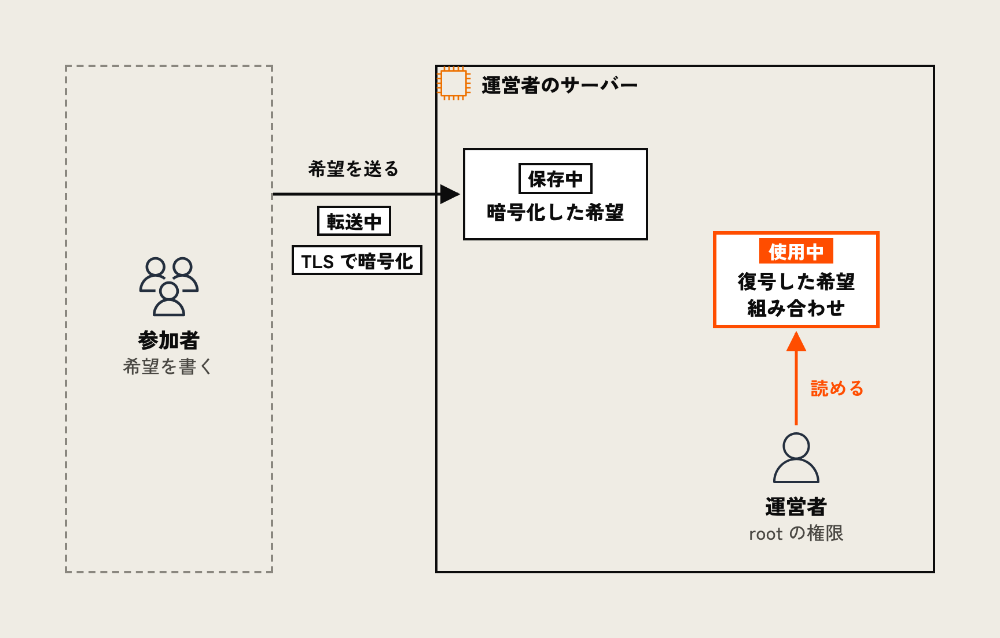
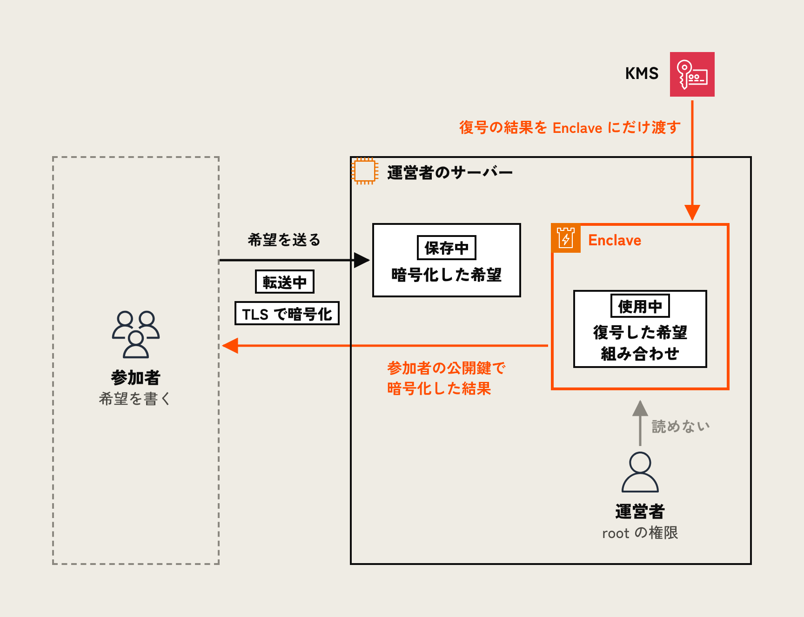
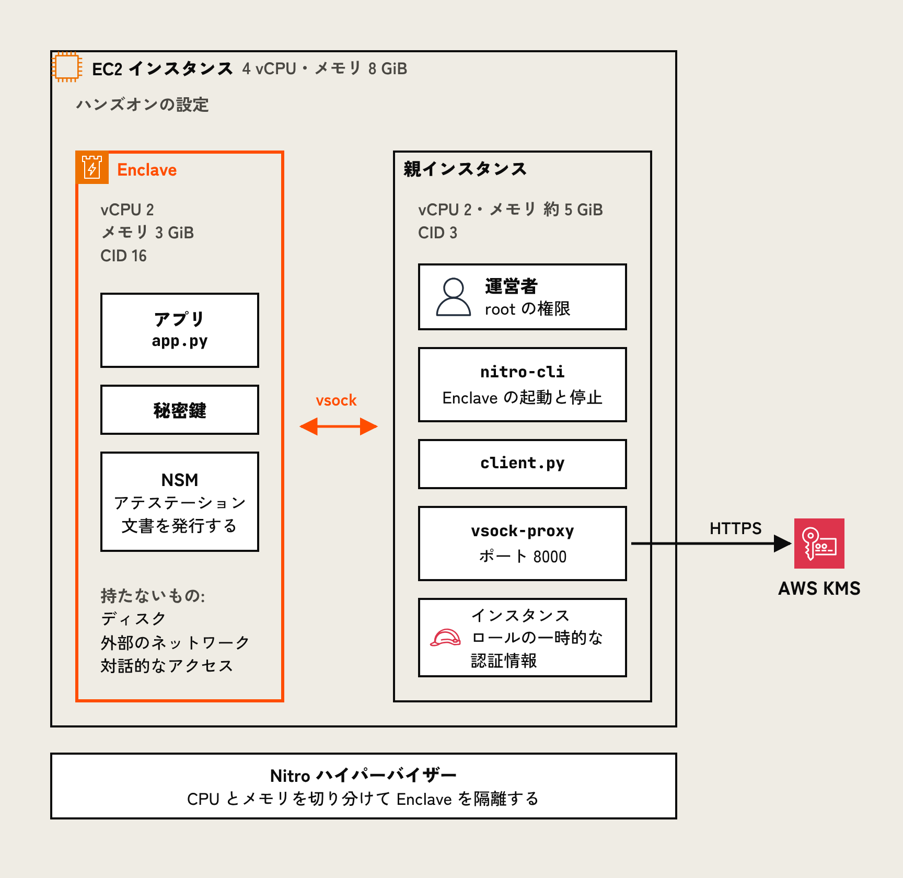
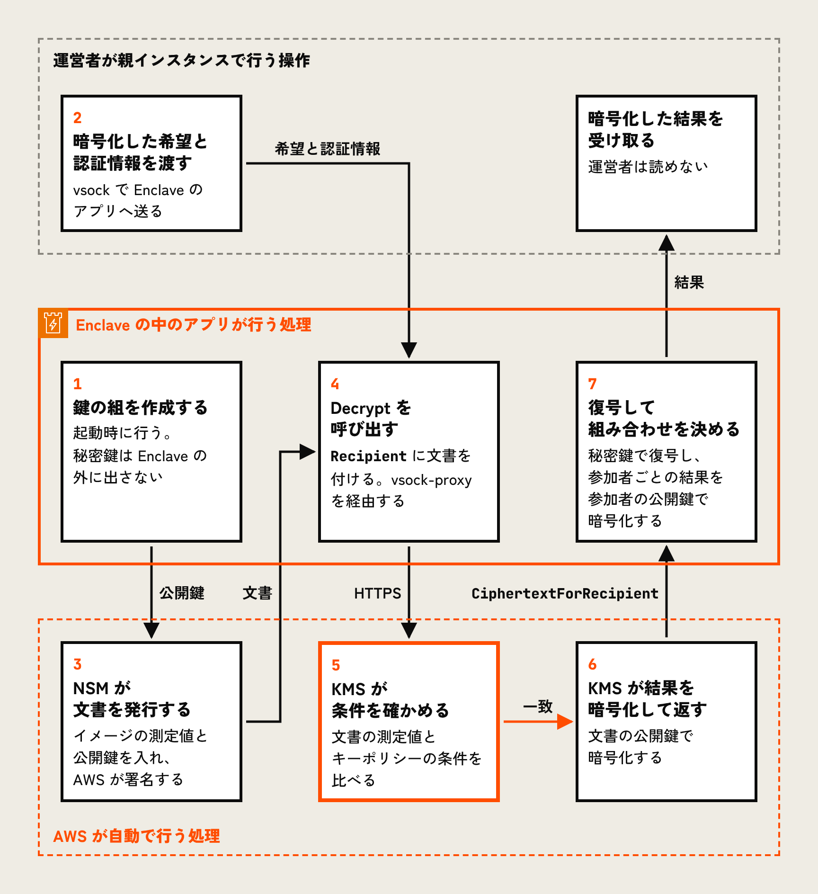
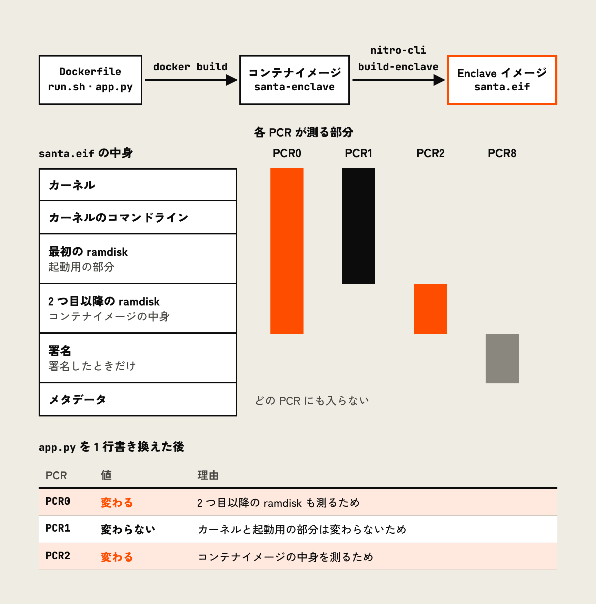
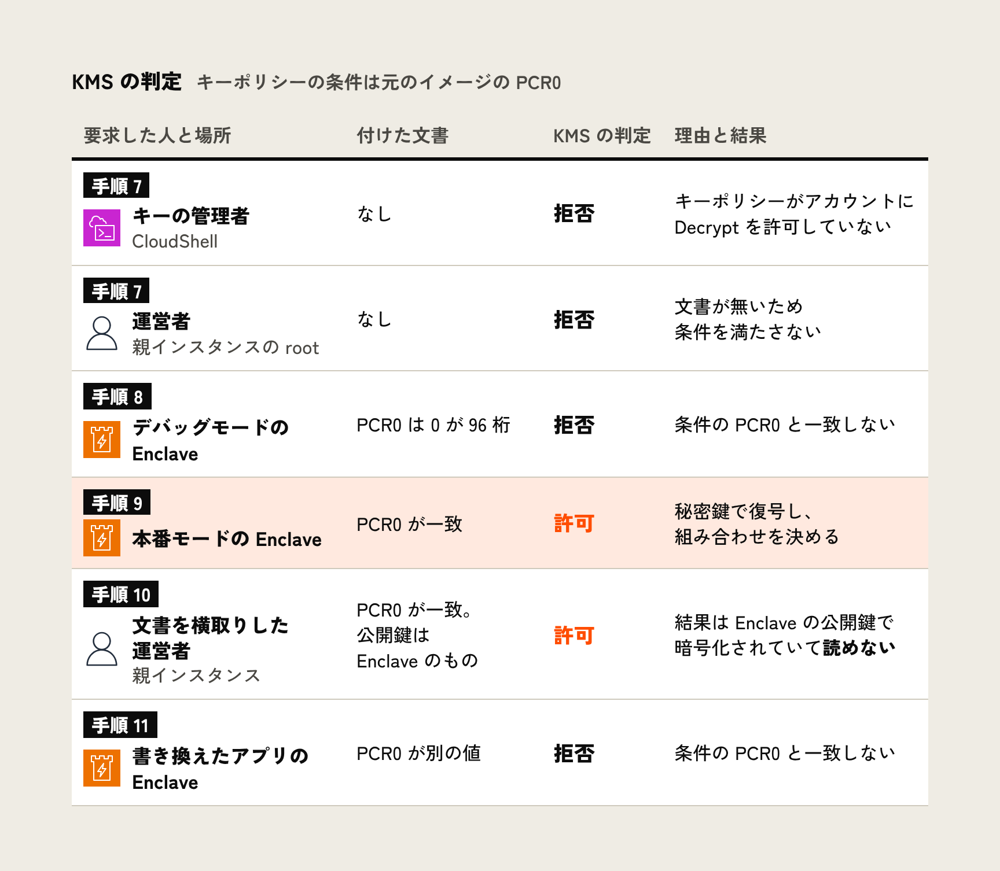
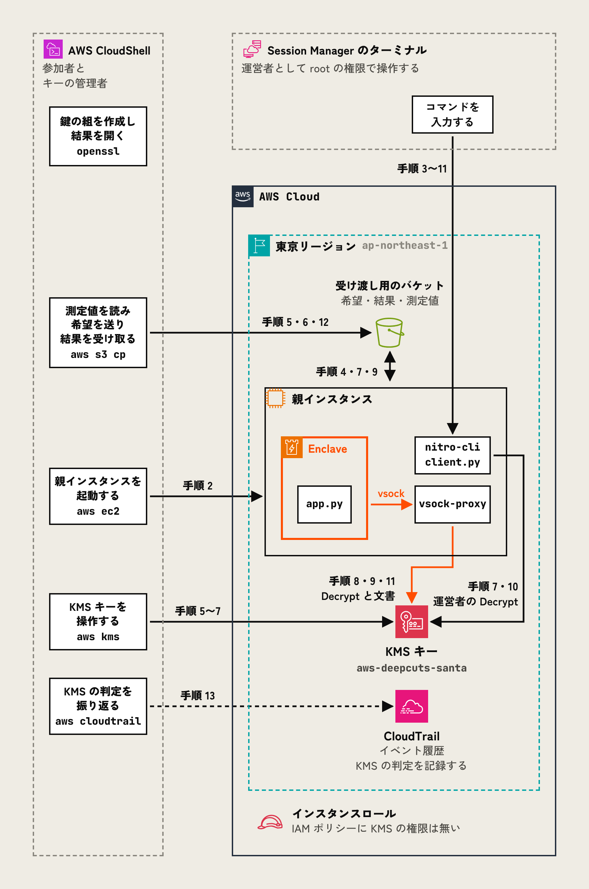

:::note info
AWS Deep Cuts の GitHub はこちらです。
https://github.com/AWS-Deep-Cuts/AWS-Deep-Cuts
:::

# AWS Deep Cutsとは？
AWS Deep Cutsは、AWS の最新のサービスやニッチな機能、または高度にアカデミックな知識を要求するサービスなど、多くの人が知らない 『隠れた名曲 = **Deep Cuts**』 を深くまで掘り下げる技術シリーズです。

このようなサービスはWeb情報も少なく、初学者は気軽にキャッチアップできないのが実情です。

そこで AWS Deep Cuts シリーズでは、**前提知識も含めた分かりやすいサービス解説** と **手順通りに進めれば誰でも再現できるハンズオン** を提供します！

# そもそも使用中のデータの保護とは？
年末の忘年会やクリスマス会で、プレゼント交換をしたことはありませんか？ 参加者がくじで贈る相手を決め、誰が誰に贈るかを秘密にしたまま贈り合う遊びを、**シークレットサンタ**と呼びます。人数が多いときは、幹事が参加者の欲しい物を集めて組み合わせを決め、各参加者に贈る相手をこっそり伝えます。

このとき、幹事だけは、全員の欲しい物と組み合わせを知っています。幹事も参加者の 1 人であれば、自分に誰が贈るのかも分かってしまいます。幹事を信頼していても、欲しい物を正直に書きにくいと感じる人もいるでしょう。以降、参加者が欲しい物を書いたものを、**希望**と呼びます。

幹事の役を Web サービスに任せても、同じことが起きます。参加者は希望をサービスに送り、サービスのサーバーが組み合わせを計算します。サーバーの OS で管理者の権限である **root** を持つ人は、サーバーのファイルやメモリの内容を読めます。以降、このサービスを運営し、サーバーの root を持つ人を**運営者**と呼びます。運営者は、幹事と同じ立場にいることになります。

希望を暗号化しても、運営者からすべてを隠せるわけではありません。サービスは、ディスクに保存する希望を暗号化できます。参加者からサーバーへ送る通信も、Web の HTTPS で使われている **TLS**（Transport Layer Security）で暗号化できます。ディスクにあるデータを**保存中のデータ**、通信の途中にあるデータを**転送中のデータ**と呼びます。しかし、組み合わせを計算するときには、サーバーは希望をメモリの上で復号しなければなりません。このデータを**使用中のデータ**と呼びます。

次の図のように、保存中のデータと転送中のデータは暗号化できても、使用中のデータは、root を持つ運営者に読めてしまいます。



同じ構造は、利用者から秘密のデータを預かって計算する多くのサービスに共通します。たとえば、複数の会社の入札額を集めて落札者を決めるサービスや、利用者の代わりに電子署名を行うサービスです。このような使い方は、活用事例の章で改めて紹介します。

シークレットサンタの例から分かるように、運営者に使用中のデータを見せないためには、まず、計算する場所を運営者から切り離す必要があります。ただし、切り離すだけでは足りません。運営者がプログラムを書き換えて、復号した希望を外に出力するようにしてしまうおそれがあるためです。そこで、データを渡す前に、計算する場所でどのプログラムが動いているのかを確かめる必要があります。暗号化した希望を復号する鍵も、確かめられた場所にだけ使わせなければなりません。さらに、組み合わせの結果も、運営者に読めない形で参加者に返す必要があります。こうした点を踏まえて、筆者は、使用中のデータを運営者から守るには、次の 4 つの条件が必要だと考えます。

| 条件 | 必要な理由 |
| --- | --- |
| 計算する場所が、サーバーの root からも隔離されている | 運営者が、使用中のデータをメモリから読めないようにする |
| 計算する場所が、どのプログラムを動かしているかを証明できる | 運営者が書き換えたプログラムに、データを渡さないようにする |
| 復号の鍵を、証明できた場所にだけ使わせる | 希望を復号できる場所を、証明できた場所に限る |
| 計算の結果も、運営者に読めない形で返す | 組み合わせを運営者に知られないようにする |

:::note info
**Confidential Computing とは**
使用中のデータを守る技術は、Confidential Computing と呼ばれます。Confidential Computing Consortium の説明によると、Confidential Computing は「ハードウェアに基づき、アテステーションされた TEE の中で計算して、使用中のデータを守ること」です。TEE（Trusted Execution Environment）は、隔離された実行環境のことです。アテステーションは、後の章で説明します。

また、AWS のブログによると、Confidential Computing には 2 つの観点があります。1 つ目は、AWS 自身から顧客のコードとデータを守る観点です。2 つ目は、顧客が自分のシステムを、信頼の度合いが異なる部品に分ける観点です。この記事の仕組みは、運営者が管理する親インスタンスから、使用中のデータを扱う部品を Enclave に切り離すため、2 つ目の観点にあたります。
:::

筆者が調べた範囲で、この 4 つの条件を満たせる AWS の仕組みが、**AWS Nitro Enclaves** と **AWS KMS**（AWS Key Management Service）の組み合わせです。KMS は、暗号化と復号を行う AWS のサービスです。ただし、4 つ目の条件は、サービスのプログラムの設計で満たします。

# AWS Nitro Enclavesとは？
AWS Nitro Enclaves は、EC2 インスタンスの vCPU とメモリの一部を切り出し、同じ物理サーバーの上に、隔離された別の VM を作成する機能です。vCPU は、インスタンスに割り当てられた仮想の CPU です。VM（Virtual Machine）は、1 台の物理サーバーの上で、独立したコンピューターとして動く仮想のマシンです。Nitro Enclaves では、vCPU とメモリを切り出す元の EC2 インスタンスを**親インスタンス**、作成した VM を **Enclave** と呼びます。

シークレットサンタに当てはめると、次の図のようになります。前の章の図と同じ枠に、Enclave と KMS を加えたものです。



前の章の図から変わったのは、次の 3 か所です。

1 つ目は、組み合わせを計算するメモリが、運営者のサーバーの中の Enclave に移ったことです。Enclave のメモリは、親インスタンスの root を持つ運営者にも読めません。

2 つ目は、上の KMS から Enclave への矢印です。図の「暗号化した希望」は、参加者が **KMS キー**で暗号化してから送ったものです。KMS キーは、KMS で作成する暗号化のキーです。参加者も Enclave も、KMS キーそのものは受け取らず、暗号化と復号を KMS に依頼します。KMS キーには、**キーポリシー**を設定します。キーポリシーは、KMS キーごとに、誰にどの操作を許可するかを定めた JSON の文書です。図のように、KMS は、キーポリシーで決めた Enclave にだけ、復号した希望を渡します。

3 つ目は、Enclave から参加者への矢印です。Enclave は、組み合わせの結果を、参加者ごとの公開鍵で暗号化して返します。公開鍵で暗号化したデータは、対になる秘密鍵でしか復号できません。公開鍵は他の人に渡してよく、秘密鍵は持ち主だけが持ちます。この 2 つを合わせて、**鍵の組**と呼びます。参加者は自分の秘密鍵を持っているため、自分の結果だけを読めます。

では、1 台の EC2 インスタンスの中で、親インスタンスと Enclave はどのように分かれているのでしょうか。次の図は、ハンズオンの設定で、4 vCPU とメモリ 8 GiB のインスタンスから、2 vCPU と 3 GiB を Enclave に切り出した例です。



Nitro Enclaves の公式の文書によると、図の左の Enclave は、ディスク・外部のネットワーク・対話的なアクセスを持たず、外とつながる経路は、親インスタンスとの間のローカルのソケットだけです。このソケットを **vsock** と呼びます。

Enclave はネットワークを持たないため、Enclave の中のアプリが KMS を呼び出すときは、図の中央の親インスタンスで動く **vsock-proxy** が通信を中継します。vsock-proxy は、Enclave から vsock で受け取った通信を、許可リストに載っている宛先にだけ転送するプログラムです。図の右の KMS へは、vsock-proxy が HTTPS で接続します。図の一番下の Nitro ハイパーバイザーは、CPU とメモリを親インスタンスと Enclave に切り分け、Enclave を隔離します。Enclave の中の NSM は、仕組みの章で説明します。

Nitro Enclaves の特徴を説明する前に、2 つの語を説明します。Enclave は、**Enclave イメージ**というファイルから起動します。Enclave イメージは、Enclave で動かすアプリと OS をまとめたファイルで、作成方法は仕組みの章で説明します。そして、Enclave イメージの中身から計算したハッシュ値を、**測定値**と呼びます。ハッシュ値は、データから決まった方法で計算する値で、中身が 1 バイトでも違えば値が変わります。

AWS Nitro Enclaves には、以下のような特徴があります。

- **親インスタンスの root からも隔離される**
  Enclave は親インスタンスとは別の VM で、親インスタンスとは vsock だけでつながります。永続的なストレージ・対話的なアクセス・外部のネットワークを持ちません。Enclave の中のプログラムの出力を親インスタンスから読む **Enclave のコンソール**も、開発用のモードで起動したときにしか使えません。このモードは、仕組みの章で説明します。
- **イメージの測定値で自分を証明できる**
  Enclave の中のアプリは、起動した Enclave イメージの測定値と、Enclave が作成した公開鍵を含む文書を取得できます。この文書には、AWS の署名が付きます。このように、Enclave が、自分がどの Enclave イメージから起動したかを、AWS の署名付きの文書で証明することを、**アテステーション**と呼びます。詳しくは仕組みの章で説明します。
- **KMS が Enclave にだけ復号したデータを渡す**
  キーポリシーに条件を書くと、特定の Enclave イメージから起動した Enclave の要求にだけ、復号を許可できます。KMS は、復号したデータを Enclave の公開鍵で暗号化して返すため、そのデータを読めるのは Enclave だけです。AWS CLI の変更履歴によると、この連携は、2023 年 5 月の AWS CLI 2.11.17 から、普通の AWS SDK と AWS CLI で使えるようになりました。Nitro Enclaves 自体は 2020 年 10 月に一般提供が始まったサービスですが、この変更によって、Nitro Enclaves 専用の SDK を使わなくても、KMS との連携を使えるようになりました。
- **Enclave の起動と停止は親インスタンスの中で行う**
  EC2 の API には、Enclave を起動・停止する操作がありません。Enclave イメージの作成と、Enclave の起動・停止は、親インスタンスの中で **nitro-cli** というコマンドで行います。EC2 の API で決めるのは、インスタンスで Enclave を使えるようにするかどうかだけです。API の仕様では、インスタンスを起動するときに、`EnclaveOptions` の `Enabled` を `true` にします。
- **追加料金がかからない**
  AWS の告知によると、Nitro Enclaves に追加料金はかかりません。<!-- 要確認: 告知の本文で確かめる -->AWS の価格表である AWS Price List にも、Nitro Enclaves 単独の項目はありません。費用は、親インスタンスなどの料金で決まります。
- **東京リージョンで使える**
  AWS の告知によると、2025 年 10 月から、すべてのリージョンで使えるようになりました。<!-- 要確認: 告知の本文で確かめる -->nitro-cli に含まれる vsock-proxy の既定の許可リストにも、東京リージョンの KMS が入っています。ハンズオンでは、東京リージョンで Enclave に対応したインスタンスタイプを、CLI で確かめてから使います。

:::note info
**EC2 インスタンス全体を証明する NitroTPM**
AWS の発表によると、2025 年 9 月に、Enclave ではなく EC2 インスタンス全体を証明する「EC2 インスタンスのアテステーション」が発表されました。この方式では、**NitroTPM** を使います。NitroTPM は、EC2 インスタンスが起動したときの測定値を記録する、仮想の TPM（Trusted Platform Module）です。KMS のキーポリシーでも、インスタンスの測定値を条件に使えるようになりました。

筆者の解釈では、インスタンス全体を証明する方式では、インスタンスの中の root を持つ人も、証明される側に含まれます。そのため、root を持つ運営者に使用中のデータを見せないという目的には、この記事で扱う Enclave の方式が合います。
:::

# 仕組み
ここまでの図で、Enclave と KMS がそれぞれ何をするのかを説明しました。この章では、まず 1 回の復号で何が起きるのかを全体の流れで示し、その後に部品ごとに説明します。各節で説明することは、次のとおりです。

| 節 | 説明すること |
| --- | --- |
| 親インスタンスと Enclave | Enclave の CPU とメモリをどこから用意し、Enclave がどの経路で外とやり取りするか |
| Enclave イメージと測定値 | Enclave イメージの中身から、どのような値を計算するか。開発用のモードでは何が変わるか |
| アテステーション文書 | Enclave が自分を証明する文書に何が入り、誰が署名するか |
| KMS による復号の許可 | KMS が復号を許可する相手をキーポリシーでどう決め、KMS が何を返すか |
| 信頼しなくてよい相手と残る信頼 | 誰を信頼しなくてよく、誰への信頼が残るか |
| 料金 | 料金の要素と計算の例 |

次の図は、Enclave の中のアプリが希望を復号し、組み合わせを決めるまでに起きることを、順に示しています。この図はハンズオンと共通です。上の帯は運営者が親インスタンスで行う操作、中央の帯は Enclave の中のアプリが行う処理、下の帯は AWS が自動で行う処理を表します。図の番号は、下の説明の番号と対応しています。



1. Enclave の中のアプリは、起動時に **RSA** の鍵の組を作成します。RSA は、公開鍵暗号の方式の 1 つです。アプリは、秘密鍵を Enclave の外へ渡しません。ハンズオンのアプリは、AWS が公開している Enclave 向けのライブラリ Nitro Enclaves SDK for C と同じく、2,048 ビットの RSA を使います。
2. 運営者は、暗号化した希望と、**インスタンスロール**の一時的な認証情報を、vsock で Enclave のアプリに渡します。インスタンスロールは、親インスタンスに付けた IAM ロールです。インスタンスの中のプログラムは、このロールの権限で AWS の API を呼び出します。Enclave は自分で認証情報を取得できないため、親インスタンスが渡します。つまり、この認証情報は運営者も持っています。
3. アプリは、**NSM**（Nitro Secure Module）に公開鍵を渡し、**アテステーション文書**を受け取ります。NSM は、Enclave の中から使える、AWS が提供する部品です。アテステーション文書は、前の章で説明したアテステーションに使う文書です。文書には Enclave イメージの測定値と公開鍵が入り、AWS の署名が付いています。
4. アプリは、文書を **`Recipient` パラメータ**に付けて、KMS の Decrypt API を呼び出します。`Recipient` パラメータは、Decrypt の要求にアテステーション文書を付けるためのパラメータです。この通信は、親インスタンスの vsock-proxy を経由します。
5. KMS は、文書が有効かを確かめ、文書の中の Enclave イメージの測定値を、キーポリシーの条件と比べます。
6. 条件に一致すると、KMS は希望を復号し、復号した希望を文書の中の公開鍵で暗号化して、**`CiphertextForRecipient`** に入れて返します。`CiphertextForRecipient` は、KMS が復号したデータを Enclave の公開鍵で暗号化して入れる、応答の項目です。
7. アプリは、秘密鍵で `CiphertextForRecipient` を復号し、組み合わせを決めます。そして、各参加者への結果を、その参加者の公開鍵で暗号化して、運営者に返します。

1 と 7 は、ハンズオンのアプリの設計です。2〜6 は、この後の節で詳しく説明します。なお、筆者の理解では、4 の通信は Enclave の中のアプリと KMS の間で TLS によって暗号化されるため、vsock-proxy は暗号化された通信を中継するだけで、その中身を読めません。

## 親インスタンスと Enclave
まず、図の 2 で運営者が使う親インスタンスと、Enclave の関係を説明します。

Enclave に渡す CPU とメモリは、親インスタンスの中で動く**アロケーター**が、あらかじめ確保します。アロケーターは、設定ファイル `/etc/nitro_enclaves/allocator.yaml` の値に従って、CPU とメモリを Enclave 用に取り分けるサービスです。既定値は CPU 2 個とメモリ 512 MiB で、ハンズオンではメモリを 3,072 MiB にします。

Intel や AMD の CPU の多くのインスタンスでは、1 つの物理コアが 2 つの vCPU として見えます。この 1 つ 1 つを、スレッドと呼びます。Linux カーネルの文書とアロケーターの実装によると、Enclave には CPU を物理コアの単位で渡し、CPU 0 を含む物理コアは親インスタンスに残します。そのため、1 つの物理コアが 2 つの vCPU として見えるインスタンスでは、親インスタンスに 1 コアの 2 vCPU を残し、Enclave に別の 1 コアの 2 vCPU を渡すことになり、合わせて 4 vCPU 以上が必要です。AWS Graviton という Arm の CPU のインスタンスでは、1 つの物理コアが 1 つの vCPU として見えるため、2 vCPU 以上が必要です。Enclave に対応しているインスタンスタイプは、`DescribeInstanceTypes` API の `NitroEnclavesSupport` で確かめられます。

同じく Linux カーネルの文書によると、Enclave に渡すメモリは最小 64 MiB で、**ヒュージページ**から渡します。ヒュージページは、大きさが 2 MiB か 1 GiB の、物理的に連続したメモリの領域です。

Enclave と親インスタンスをつなぐ vsock では、各 VM を **CID**（Context Identifier）という番号で区別します。親インスタンスの CID は 3 で、ハンズオンの Enclave には 16 を割り当てます。

Enclave から KMS への通信は、前の章の図のとおり、親インスタンスの vsock-proxy が中継します。nitro-cli の文書によると、vsock-proxy の転送先は許可リストで制限され、既定の許可リストには東京リージョンの KMS が入っています。また、nitro-cli のパッケージに含まれるサービスとして vsock-proxy を起動すると、vsock-proxy はインスタンスのリージョンの KMS に転送します。

ここで、図の 2 で運営者が認証情報を渡す理由を説明します。EC2 インスタンスの中のプログラムは、通常、**IMDS**（Instance Metadata Service）から認証情報を取得します。IMDS は、インスタンスの中のプログラムが、インスタンスの情報とインスタンスロールの一時的な認証情報を取得する仕組みです。しかし、Enclave はネットワークを持たないため、IMDS に届きません。そのため、Enclave は IAM の認証情報を持たず、公式のサンプルでは、親インスタンスがインスタンスロールの一時的な認証情報を取得して、vsock で Enclave に渡します。認証情報そのものは、運営者も持っていることになります。それでも運営者が希望を復号できない理由は、「KMS による復号の許可」の節で説明します。

## Enclave イメージと測定値
次に、図の 3 と 5 で使う測定値が、何から計算されるのかを説明します。

Enclave イメージは、**Docker** で作成したコンテナイメージから作成します。Docker は、アプリと必要なファイルを**コンテナイメージ**にまとめ、実行するツールです。ハンズオンでは、親インスタンスで次の 2 つのコマンドを実行します。

```bash
docker build -t santa-enclave:latest enclave/
nitro-cli build-enclave --docker-uri santa-enclave:latest --output-file santa.eif | tee build-output.json
```

1 つ目の `docker build` は、Dockerfile とアプリのファイルから、コンテナイメージ `santa-enclave:latest` を作成します。2 つ目の `nitro-cli build-enclave` は、そのコンテナイメージから Enclave イメージを作成し、Enclave イメージの測定値を表示します。測定値の中身は、この後で説明します。Enclave イメージのファイルの形式を EIF（Enclave Image File）と呼び、ハンズオンでは `santa.eif` というファイルになります。

:::note info
**名前に「イメージ」が付く 3 つのもの**
この記事には、名前に「イメージ」が付くものが 3 つ出てきます。

| 名前 | 何か | 誰が用意するか |
| --- | --- | --- |
| AMI | AMI（Amazon Machine Image）は、親インスタンスの OS のイメージ。ハンズオンでは Amazon Linux 2023 を使う | AWS が公開しているものから選ぶ |
| コンテナイメージ | Dockerfile から `docker build` で作成するイメージ。Enclave で動かすアプリと OS のファイルを含む | Enclave で動かすアプリを用意する人が作成する |
| Enclave イメージ | Enclave の起動に使う EIF のファイル。コンテナイメージから `nitro-cli build-enclave` で作成する | Enclave で動かすアプリを用意する人が作成する |

以降、単に「イメージ」と書くときは、Enclave イメージを指します。
:::

では、測定値はイメージのどの部分から計算されるのでしょうか。EIF の形式の文書によると、nitro-cli は、イメージの部分ごとに SHA-384 のハッシュ値を計算し、**PCR**（Platform Configuration Register）と呼ぶ番号付きの欄に記録します。前の章で説明した測定値は、この PCR の値です。次の図は、イメージの部分と PCR の対応を示しています。



図と次の表の **ramdisk** は、メモリの上に展開して使うファイルシステムのデータです。

| PCR | 測る対象 | 値が変わるとき |
| --- | --- | --- |
| PCR0 | カーネル・カーネルのコマンドライン・すべての ramdisk | イメージの中身が変わったとき |
| PCR1 | カーネル・カーネルのコマンドライン・最初の ramdisk | 起動用の部分が変わったとき |
| PCR2 | 2 つ目以降の ramdisk。コンテナイメージの中身が入る | アプリやライブラリが変わったとき |
| PCR8 | 署名に使った証明書 | 署名したイメージにだけ値が入る |

EIF の形式の文書によると、EIF のメタデータは、どの PCR にも含まれません。Nitro Enclaves SDK for C の文書も、イメージを作成し直せば同じ測定値が出力されると説明しています。ただし、これは同じコンテナイメージから作成し直す場合です。`docker build` からやり直すと、インストールされるパッケージの版などが変わり、PCR0 が変わることがある、と第三者から報告されています。

一方、PCR0 と PCR2 はアプリの中身を測るため、アプリを 1 バイトでも変えると値が変わります。キーポリシーの条件を PCR0 で書く場合は、アプリを変えるたびにキーポリシーを更新します。Nitro Enclaves のユーザーガイドでは、イメージに署名し、署名に使った証明書の PCR8 を条件にすれば、同じ証明書で署名する限り、キーポリシーを更新せずに済む、と説明されています。<!-- 要確認: ユーザーガイドの原文で確かめる -->

前の章で触れた開発用のモードは、**デバッグモード**と呼ばれます。nitro-cli で Enclave を起動するときに `--debug-mode` を付けると、Enclave はデバッグモードで起動し、親インスタンスから Enclave のコンソールに接続して、Enclave の中のプログラムの出力を読めるようになります。その代わり、Nitro Enclaves SDK for C の文書によると、デバッグモードの Enclave のアテステーション文書では、PCR0 が 0 の 96 桁になります。本番の Enclave とデバッグモードの Enclave を区別するためです。2026 年 11 月にハンズオンを実機で検証したときは、PCR1 と PCR2 も 0 になりました。この記事では、`--debug-mode` を付けずに起動するモードを、**本番モード**と呼びます。

ここで、取り違えやすい点が 1 つあります。nitro-cli の実装では、`nitro-cli describe-enclaves` が表示する PCR は、親インスタンスの nitro-cli が EIF のファイルから計算した値で、デバッグモードでも 0 になりません。KMS が条件と比べるのは、NSM がアテステーション文書に入れた値のほうです。ハンズオンの手順 8 では、この 2 つの値を並べて確かめます。

:::note info
**Enclave のメモリは EIF の 4 倍以上**
Enclave に渡すメモリの量にも、イメージが関係します。Nitro Enclaves のユーザーガイドと `nitro-cli explain E26` の説明文は、Enclave のメモリを「EIF のサイズ以上」と説明しています。<!-- 要確認: ユーザーガイドの原文で確かめる -->しかし、nitro-cli 1.5.2 の実装は、Enclave に渡すメモリが EIF のファイルのサイズの 4 倍以上かを検査し、足りなければ E26 のエラーで止まります。また、アロケーターが確保した量を超えるメモリを指定すると、E27 のエラーになります。
:::

## アテステーション文書
続いて、図の 3 で NSM が発行するアテステーション文書の中身を説明します。

NSM の API の定義によると、Enclave の中のアプリが NSM のデバイス `/dev/nsm` に依頼できる操作は 7 つあります。PCR の値を読む `DescribePCR` や、乱数を取得する `GetRandom` などがあり、アテステーション文書は `Attestation` という操作で受け取ります。改めて定義すると、アテステーションは、Enclave が、自分がどのイメージから起動したかを、AWS の署名付きの文書で証明することです。

NSM の文書によると、アテステーション文書の主な項目は、次のとおりです。

| 項目 | 内容 |
| --- | --- |
| `module_id` | 文書を発行した NSM の ID。親インスタンスの ID と Enclave の ID からなる |
| `timestamp` | 文書を作成した時刻。UTC のミリ秒で表す |
| `digest` | 測定値の計算に使ったハッシュの方式。値は `SHA384` |
| `pcrs` | PCR の番号と値の組。PCR0 などの測定値が入る |
| `certificate`・`cabundle` | 文書の署名を確かめるための証明書と、その証明書をたどるための証明書の一覧 |
| `public_key` | 任意。Enclave の中のアプリが渡した公開鍵 |
| `user_data`・`nonce` | 任意。アプリが渡した任意のデータと、要求ごとに 1 回だけ使う値 |

NSM の文書によると、Enclave の信頼の起点は **AWS Nitro システム**にあり、文書には **AWS Nitro Attestation PKI** が署名します。AWS Nitro システムは、Nitro ハイパーバイザーを含む、EC2 インスタンスを動かす AWS の仕組みです。PKI（Public Key Infrastructure）は、公開鍵の持ち主を証明書で保証する仕組みです。文書を受け取ったサービスは、証明書をたどって、文書に AWS の署名が付いていることを確かめます。

文書に公開鍵を入れておくと、文書を受け取ったサービスは、その公開鍵でデータを暗号化して返せます。このデータを復号できるのは、対になる秘密鍵を持つ Enclave だけです。KMS の `CiphertextForRecipient` も、この仕組みを使っています。ただし、NSM の文書は、公開鍵だけでは、同じ文書を後から送り直す再送を防げないと注意しています。再送を見分けるには、要求ごとに異なる値を `nonce` に入れて文書を作成し、受け取る側でその値を確かめます。`user_data` と `nonce` には、それぞれ 512 バイト以内の値を入れます。

KMS は、文書の署名と測定値を確かめる機能を持っています。一方で、KMS と連携しない自作のサービスなどに秘密のデータを渡す場合は、署名・証明書のチェーン・PCR の比較といった文書の検証の手順を、サービスの側で実装する必要があります。

## KMS による復号の許可
ここからは、図の 4〜6 で KMS が何をするのかを説明します。前の章で説明したとおり、AWS KMS は、暗号化に使うキーを作成・管理し、暗号化と復号を行うサービスです。この節では、KMS が復号を許可するかどうかを決めるキーポリシーの中身を、ハンズオンの例で確かめます。

API の仕様では、KMS の操作のうち、`Recipient` パラメータを受け付けるのは、Decrypt・DeriveSharedSecret・GenerateDataKey・GenerateDataKeyPair・GenerateRandom の 5 つです。この記事とハンズオンでは、Decrypt を使います。

`Recipient` パラメータには、暗号化の方式を表す `KeyEncryptionAlgorithm` と、アテステーション文書を入れる `AttestationDocument` を指定します。`KeyEncryptionAlgorithm` に指定できるのは、`RSAES_OAEP_SHA_256` だけです。API の仕様によると、`Recipient` を付けた Decrypt では、KMS は平文を返さず、復号したデータを文書の公開鍵で暗号化して `CiphertextForRecipient` に入れて返します。このとき、平文を入れる `Plaintext` は空になります。また、`CiphertextForRecipient` が応答に含まれるのは、有効なアテステーション文書を渡したときだけです。

`CiphertextForRecipient` は、CMS（Cryptographic Message Syntax）の EnvelopedData という形式のデータとして扱います。AWS が公開している NitroTPM のツールの例は、`openssl cms -decrypt` で復号しています。ハンズオンの Enclave のアプリも、同じ方法で復号します。次のコードは、ハンズオンのアプリ `app.py` の中で、希望を 1 件復号する関数です。

```python
def decrypt_wish(kms, blob, doc):
    """KMS に Decrypt を依頼し、返ってきた CiphertextForRecipient を Enclave の秘密鍵で復号する"""
    resp = kms.decrypt(
        CiphertextBlob=blob,
        Recipient={
            "KeyEncryptionAlgorithm": "RSAES_OAEP_SHA_256",
            "AttestationDocument": doc,  # NSM が発行した文書。PCR0 と Enclave の公開鍵が入っている
        },
    )
    # Plaintext は返らない。KMS は、復号した希望を文書の公開鍵で暗号化して返す
    envelope = resp["CiphertextForRecipient"]
    with tempfile.NamedTemporaryFile(dir="/tmp", suffix=".der") as f:
        f.write(envelope)
        f.flush()
        out = subprocess.run(
            ["openssl", "cms", "-decrypt", "-inform", "DER",
             "-inkey", "/tmp/enclave-key.pem", "-in", f.name],
            check=True, capture_output=True)
    return json.loads(out.stdout)
```

`kms` は、運営者から受け取ったインスタンスロールの認証情報で作成した、AWS SDK for Python である boto3 の KMS のクライアントです。`/tmp/enclave-key.pem` は、図の 1 でアプリが作成した秘密鍵で、Enclave の中にだけあります。

では、KMS は、この要求を誰に許可するのでしょうか。ハンズオンで作成する KMS キーのキーポリシーは、次のとおりです。アカウント ID は、説明用の値 111122223333 にしています。`<PCR0>` の部分には、ハンズオンで作成したイメージの PCR0 が入ります。

```json
{
  "Version": "2012-10-17",
  "Statement": [
    {
      "Sid": "AllowKeyAdministration",
      "Effect": "Allow",
      "Principal": { "AWS": "arn:aws:iam::111122223333:root" },
      "Action": [
        "kms:CreateAlias", "kms:Describe*", "kms:Enable*", "kms:List*", "kms:Put*",
        "kms:Update*", "kms:Revoke*", "kms:Disable*", "kms:Get*", "kms:Delete*",
        "kms:TagResource", "kms:UntagResource", "kms:ScheduleKeyDeletion", "kms:CancelKeyDeletion"
      ],
      "Resource": "*"
    },
    {
      "Sid": "AllowEncryptForParticipants",
      "Effect": "Allow",
      "Principal": { "AWS": "arn:aws:iam::111122223333:root" },
      "Action": "kms:Encrypt",
      "Resource": "*"
    },
    {
      "Sid": "AllowDecryptOnlyFromEnclave",
      "Effect": "Allow",
      "Principal": { "AWS": "arn:aws:iam::111122223333:role/aws-deepcuts-enclave-parent-role" },
      "Action": "kms:Decrypt",
      "Resource": "*",
      "Condition": {
        "StringEqualsIgnoreCase": {
          "kms:RecipientAttestation:ImageSha384": "<PCR0>"
        }
      }
    }
  ]
}
```

キーポリシーは、`Statement` の中に 1 つ以上の**ステートメント**を並べたものです。ステートメントは、誰に・どの操作を・どの条件で許可するかを定めた 1 つの規則です。`Principal` には、操作を許可する相手である**プリンシパル**を書きます。プリンシパルは、AWS にリクエストを送る IAM ユーザーや IAM ロールなどです。`Condition` には、リクエストの情報を表す**条件キー**と、条件キーの値と比べる値を書きます。

例の 1 つ目と 2 つ目のステートメントのプリンシパル `arn:aws:iam::111122223333:root` は、**アカウントを表すプリンシパル**です。名前に root を含みますが、AWS アカウントのルートユーザーのことではありません。キーポリシーでアカウントを表すプリンシパルに操作を許可すると、その操作は、IAM ポリシーで許可された、アカウントの中の IAM ユーザーと IAM ロールも使えるようになります。この記事では、キーポリシーで管理の操作を許可された人を、**キーの管理者**と呼びます。ハンズオンでは、あなたがキーの管理者の役も演じます。

この例の 3 つのステートメントは、次のとおりです。

| Sid | プリンシパル | 許可する操作 | 条件 |
| --- | --- | --- | --- |
| `AllowKeyAdministration` | アカウントを表すプリンシパル | キーの管理の操作。エイリアスの作成・キーポリシーの変更・キーの削除の予約など | なし |
| `AllowEncryptForParticipants` | アカウントを表すプリンシパル | Encrypt | なし |
| `AllowDecryptOnlyFromEnclave` | インスタンスロール | Decrypt | アテステーション文書の PCR0 が `<PCR0>` と一致する |

表のエイリアスは、KMS キーに付ける別名です。ハンズオンでは、`alias/aws-deepcuts-santa` というエイリアスを付けます。

3 つ目のステートメントの条件キー `kms:RecipientAttestation:ImageSha384` は、要求に付いたアテステーション文書の PCR0 を表します。他の PCR を条件にするときは、`kms:RecipientAttestation:PCR1` のように、`kms:RecipientAttestation:PCR<番号>` の形の条件キーを使います。KMS 開発者ガイドのソースは GitHub のリポジトリでも公開されており、このリポジトリの更新は 2023 年 6 月で止まっています。この記事では、このリポジトリの最後の版を「KMS 開発者ガイドの旧版」と呼び、本文を直接確かめられる旧版の記述を示します。旧版は、PCR の値の比較に、大文字と小文字を区別しない `StringEqualsIgnoreCase` を使うよう勧めています。値は 96 桁の 16 進数で、Nitro Enclaves SDK for C の例と同じく、先頭に `0x` を付けません。

KMS 開発者ガイドの旧版によると、要求にアテステーション文書が含まれていなければ、この条件は満たされず、許可されません。つまり、インスタンスロールの認証情報を持つ運営者が、親インスタンスから文書を付けずに Decrypt を呼び出しても、このステートメントでは許可されません。図の 2 で運営者が認証情報を持っていても希望を復号できない理由は、ここにあります。

ここで、見落としやすい点があります。KMS キーの既定のキーポリシーや、AWS が公開している Nitro Enclaves のワークショップのキーポリシーのひな形は、アカウントを表すプリンシパルに `kms:*` を許可しています。この形のままでは、IAM ポリシーで `kms:Decrypt` を許可された人は、アテステーション文書なしで希望を復号できます。以降、このように IAM ポリシーで AWS の操作を広く許可された人を、**IAM の管理者**と呼びます。このように復号されることを防ぐため、ハンズオンのキーポリシーは、アカウントを表すプリンシパルに管理の操作と Encrypt だけを許可し、Decrypt は許可していません。そのため、すべての操作を許可する管理ポリシー `AdministratorAccess` を持つ IAM の管理者でも、キーポリシーを書き換えない限り、Decrypt は拒否されます。

もう 1 つ注意が必要なのが、**グラント**です。グラントは、キーポリシーを変えずに、特定のプリンシパルに KMS キーの操作を許可する仕組みです。AWS のサービス認可リファレンス（Service Authorization Reference）によると、`kms:Create*` には、グラントを作成する CreateGrant も含まれます。

AWS が Nitro Enclaves SDK for C で公開しているサンプルの kmstool の手順は、キーポリシーで、キーの管理者のロールに `kms:Create*` を許可しています。このように `kms:Create*` を許可すると、管理者はキーポリシーを書き換えずに、グラントで自分に Decrypt を許可できます。そのため、ハンズオンのキーポリシーは、作成の操作として `kms:CreateAlias` だけを許可しています。ただし、管理の操作には、キーポリシーを書き換える `kms:PutKeyPolicy` も含まれます。この点は、次の「信頼しなくてよい相手と残る信頼」の節で説明します。

また、ハンズオンのキーポリシーは、インスタンスロールに Encrypt を許可していません。kmstool の手順のキーポリシーは、インスタンスロールに Encrypt を許可しています。しかし、筆者は、運営者が偽の希望を暗号化して紛れ込ませたり、参加者の公開鍵を差し替えたりできないように、Encrypt を許可しない設計にしました。ハンズオンでは、参加者が、希望と自分の公開鍵を 1 つにまとめて KMS で暗号化します。

最後に、運営者が、Enclave が作成したアテステーション文書を横取りして、自分で KMS に送る場合を考えます。文書の PCR0 は条件と一致するため、KMS は要求を許可します。しかし、KMS が返す `CiphertextForRecipient` は、文書の中の Enclave の公開鍵で暗号化されています。対になる秘密鍵は Enclave の中にしかないため、運営者は復号した希望を読めません。

ハンズオンでは、ここまでの仕組みを 6 通りの復号の要求で確かめます。内訳は、4 回ののぞき見で試す 5 通りの要求と、本番モードの Enclave が送る正しい要求です。のぞき見 1 では、キーの管理者と運営者の 2 人がそれぞれ復号を試みます。次の図は、それぞれの要求に KMS がどう判定したかをまとめたものです。KMS が許可するのは文書の PCR0 が条件と一致した要求だけで、許可されても復号した希望を読めるのは Enclave だけであることを確かめてください。図の手順の番号は、ハンズオンの README の手順の番号です。



## 信頼しなくてよい相手と残る信頼
ここまでの仕組みを、「誰を信頼しなくてよいのか」の観点で整理します。

| 相手 | 信頼しなくてよいか | 理由 |
| --- | --- | --- |
| 親インスタンスの root を持つ運営者 | 希望と組み合わせの中身については、信頼しなくてよい | Enclave のメモリを読めない。文書の無い要求は許可されない。文書を横取りしても復号した希望を読めない |
| キーの管理者と IAM の管理者 | 信頼が残る | キーポリシーを書き換えない限り復号できないが、書き換えれば自分に復号を許可できる |
| イメージを作成する人 | 信頼が残る | PCR0 が示すのは、どのイメージかであって、安全なイメージかではない |
| AWS | 信頼が残る | アテステーション文書の信頼の起点は AWS Nitro システムで、AWS Nitro Attestation PKI が署名する |

キーの管理者は、キーポリシーの条件をいつでも変えられます。ハンズオンのキーポリシーは、管理の操作をアカウントを表すプリンシパルに許可しているため、IAM ポリシーで `kms:PutKeyPolicy` を許可された IAM の管理者も、キーの管理者にあたります。キーポリシーの変更は、**AWS CloudTrail** に記録されます。CloudTrail は、AWS の API の呼び出しを記録するサービスで、キーポリシーの変更のような、リソースの設定を変える操作を、**管理イベント**として記録します。

また、前の節で説明したとおり、`kms:Create*` を許可する書き方では、キーポリシーを書き換えずに、グラントでも復号を許可できます。さらに、API の説明によると、キーの管理者は、エイリアスを別の KMS キーに向け直せます。そのため、実際のサービスでは、参加者は、暗号化の前に、キーの ARN とキーポリシーを自分で確かめる必要があります。ARN（Amazon Resource Name）は、AWS のリソースを一意に識別する名前です。

イメージを作成する人を信頼しなくて済むようにするには、参加者がアプリのソースを読み、同じ手順でイメージを作成し直して、PCR0 が一致することを確かめる必要があります。

表の他にも、Enclave では守れないことがあります。

- 親インスタンスは、nitro-cli の `terminate-enclave` で、Enclave をいつでも停止できます。そのため、Enclave が守るのは中身の秘密であって、処理が必ず最後まで実行されることではありません。第三者である Trail of Bits の記事によると、親インスタンスからのサービス妨害は、Enclave では防げません。
- 運営者は、希望を読めなくても、どの希望を Enclave に送るか、どの回の結果を参加者に配るかは決められます。たとえば、組み合わせを何度も決め直して別々の回の結果を配ったり、一部の参加者の希望を送らずに外したりできます。

後者への対策として、筆者は、Enclave が結果の本文に参加者全員の名前と回の番号を入れて暗号化する方法を考えます。この方法なら、参加者は、自分の結果がどの回の、誰を含む組み合わせかを確かめられます。ただし、ハンズオンのアプリは、結果の本文を 2,048 ビットの RSA で暗号化できる 190 バイト以内に収めるため、この対策を実装していません。

## 料金
最後に、Nitro Enclaves を使うときの料金を説明します。前の章で説明したとおり、Nitro Enclaves そのものに追加料金はかかりません。費用は、親インスタンス・EBS・パブリック IPv4 アドレス・KMS と、受け渡し用のバケットとデータ転送で決まります。受け渡し用のバケットは、ハンズオンで CloudShell と親インスタンスの間で希望や結果を受け渡す S3 バケットです。単価は、2026 年 11 月 1 日に取得した AWS Price List の、東京リージョンの値です。

| 料金の要素 | かかるとき | 東京リージョンの単価 |
| --- | --- | --- |
| EC2 のオンデマンドインスタンス c6i.xlarge | 親インスタンスが起動している間 | 1 時間あたり $0.214 |
| EBS の gp3 | ボリュームを削除するまで | GB 月あたり $0.096 |
| パブリック IPv4 アドレス | アドレスを割り当てている間 | 1 時間あたり $0.005 |
| KMS キー | キーを削除するまで | キーのバージョン 1 つあたり月 $1.00 |
| KMS のリクエスト | Encrypt や Decrypt を呼び出したとき | 1 万件あたり $0.03。全リージョンの合計で月 2 万件まで無料 |
| S3 Standard の保存 | 受け渡し用のバケットにオブジェクトを保存している間 | 最初の 50 TB は GB 月あたり $0.025 |
| S3 のリクエスト | 受け渡し用のバケットにオブジェクトを書き込んだり、読み出したりしたとき | PUT・COPY・POST・LIST は 1,000 件あたり $0.0047、GET は 1 万件あたり $0.0037 |
| インターネットへのデータ転送 | AWS からインターネットへデータを送信したとき | 全世界の合計で月 100 GB まで無料。その後は GB あたり $0.114 |

KMS キーの月額は、KMS 開発者ガイドの旧版によると、時間で按分されます。また、API の仕様では、キーは、削除を予約してから 7〜30 日の待機期間の後に削除されます。この待機期間に料金がかかるかは、公式の記載を確認できませんでした。そのため、次の計算では、待機期間にも料金がかかるものとして扱います。

計算の例として、ハンズオンの費用の上限の目安を示します。ハンズオンでは、c6i.xlarge の親インスタンスを最大 4 時間動かし、30 GiB の EBS を使います。正確には、課金される時間は、自動で終了する設定が動き始めるまでの時間と、終了の処理にかかる時間の数分だけ、4 時間を超えます。次の計算では 4 時間とし、この数分は含めません。KMS キーは 1 本で、ハンズオンの 4 時間と、最短の待機期間の 7 日を合わせた 172 時間分の料金がかかるものとします。1 か月は 730 時間として按分します。

| 要素 | 計算 | 上限 |
| --- | --- | --- |
| EC2 | $0.214 × 4 時間 | $0.856 |
| EBS | 30 GB × $0.096 × 4 時間 ÷ 730 時間 | $0.016 |
| パブリック IPv4 アドレス | $0.005 × 4 時間 | $0.020 |
| KMS キー | $1.00 × 172 時間 ÷ 730 時間 | $0.236 |
| KMS のリクエスト | 100 件 × $0.000003 | $0.001 未満 |
| S3 とデータ転送 | 受け渡し用のバケットの 1 GB 以下の保存とリクエスト、インターネットへの 0.1 GB の送信 | $0.014 未満 |
| **合計** | | **約 $1.14** |

1 ドル 160 円で換算すると、約 180 円です。KMS キーの月額が時間で按分されない場合は、KMS キーの行が $1.00 になり、合計は約 $1.91、約 310 円になります。いずれの場合も、費用の大半は、親インスタンスが起動している時間で決まります。

# AWS Nitro Enclavesの主な活用事例
ここまでで、Nitro Enclaves と KMS を組み合わせると、運営者にも中身を見せずにデータを計算できることを説明しました。この仕組みは、シークレットサンタの他にも、次のような場面で使われています。いずれも、AWS のブログ・公式のサンプル・公開されている事例の紹介をもとに、筆者が整理したものです。

- **複数の組織のデータを持ち寄って計算する**
  AWS のブログによると、複数の買い手がそれぞれの KMS キーで入札を暗号化し、各キーのキーポリシーに Enclave の PCR を書いておき、親インスタンスが集めた入札を Enclave の中で計算する入札サービスの例があります。入札額を締め切りまで秘密にするオークションも、同じ構造で作成できます。
- **秘密鍵を扱う処理を分離する**
  公開されている事例の紹介によると、暗号資産のウォレットの鍵の管理のように、秘密鍵を扱う処理を Enclave に分けて実行する例があります。
- **運営者自身もデータを読めないようにする**
  AWS の顧客事例の中で、金融向けの生成 AI のサービスを提供するスタートアップは、今後の取り組みとして「Nitro Enclaves を使えば、自分たちを自分たちの環境から締め出し、顧客がデータを完全に所有したまま安全にアクセスできるようになる」と述べています。
- **TLS 証明書の秘密鍵を守る**
  ACM（AWS Certificate Manager）の証明書を Enclave で使う、ACM for Nitro Enclaves があります。API の説明によると、証明書の秘密鍵は、アテステーションに基づくキーポリシーを付けた AWS 管理のキーで暗号化されます。
- **Kubernetes のノードで使う**
  AWS は、Kubernetes のノードで Enclave を使うためのデバイスプラグインを公開しています。1 つのノードで動かす Enclave の数を設定でき、既定は 4 です。

# AWS Nitro Enclavesを使う際のベストプラクティス
ここまでの仕組みを踏まえて、Nitro Enclaves と KMS を組み合わせるときに守りたいことを 5 つ挙げます。公式の資料に基づく項目と、第三者の指摘や筆者の考えに基づく項目は、本文で書き分けています。

- **本番のキーポリシーに 0 の PCR0 を書かない**
  kmstool の手順は、デバッグモードで試すために、0 が 96 桁並んだ PCR0 をキーポリシーの条件に書いています。デバッグモードの Enclave では、Enclave のコンソールで中のプログラムの出力を読めます。そのため、この値を本番のキーポリシーに残すと、中を見られる Enclave に復号を許可することになります。公式の手順も、本番モードでは、イメージの作成時に表示された PCR0 を条件にした新しいキーを作成しています。
- **アカウントに Decrypt とグラントの作成を許可しない**
  キーポリシーでアカウントを表すプリンシパルに `kms:*` を許可すると、IAM ポリシーで復号を許可された人が、文書なしで復号できます。`kms:Create*` を許可すると、CreateGrant も含まれるため、グラントで復号を許可できます。管理の操作は、`kms:CreateAlias` のように、使う操作の名前を書いて許可します。
- **データを預ける人が測定値を確かめられるようにする**
  PCR0 は、同じコンテナイメージから作成し直せば同じ値になります。Enclave のアプリのソースとイメージの作成手順を公開し、データを預ける人が、イメージを作成し直して PCR0 を確かめられるようにします。`docker build` からやり直しても同じ PCR0 になるように、ビルドを再現できるようにする方法も、第三者から紹介されています。
- **Enclave からの復号を CloudTrail で確かめる**
  KMS 開発者ガイドの旧版の例では、Enclave からの Decrypt の CloudTrail の記録の `additionalEventData.recipient` に、Enclave のモジュール ID と PCR0 が残ります。2026 年 11 月にハンズオンを実機で検証したときは、PCR の値は 16 進数ではなく base64 で記録されました。また、拒否された要求では `additionalEventData` が null で、文書を付けていても PCR は記録されませんでした。記録から分かるのは、どのイメージの文書を付けた要求が、いつ許可されたかであって、要求を送ったのが Enclave かどうかではありません。運営者が文書を横取りして送った要求も、同じ PCR0 で記録されます。それでも、復号した希望を読めるのは、その文書の公開鍵に対応する秘密鍵を持つ Enclave だけです。なお、Prowler のチェックの一覧によると、第三者のセキュリティツールである Prowler は、CloudTrail の記録から、デバッグモードの Enclave からの呼び出しを見つけるチェックを提供しています。
- **公式のライブラリとサンプルは新しい版を使う**
  AWS が公開している Nitro Enclaves のワークショップの Dockerfile は、Nitro Enclaves SDK for C の v0.4.0 を指定しています。SDK for C には 2026 年にも修正が続き、2026 年 11 月 1 日時点の最新は、2026 年 8 月 14 日の v0.4.6 です。第三者である Trail of Bits の 2026 年 8 月の記事によると、同社は KMS との連携の脅威を挙げ、SDK for C に問題を報告しました。<!-- 要確認: 記事の本文で確かめる -->公式のサンプルを使うときは、指定されている版を確かめ、新しい版に上げます。

# ハンズオンはこちら！
ここまでの仕組みは、ハンズオンで実際に確かめられます。ハンズオンでは、自分の AWS アカウントの中で、あなたが参加者・キーの管理者・運営者の 3 つの役を 1 人で演じます。キーの管理者と運営者として、希望を読もうとする 4 つの方法を試します。ハンズオンでは、この試みを**のぞき見**と呼びます。4 回ののぞき見のどの方法でも希望を読めないことを確かめてから、参加者として結果を開きます。

親インスタンスは、東京リージョンの EC2 インスタンスです。操作は、AWS CloudShell と Session Manager のターミナルで行います。AWS CloudShell は、ブラウザから AWS CLI のコマンドを実行できる環境です。Session Manager は、AWS Systems Manager の機能で、ブラウザから EC2 インスタンスのシェルを使えます。親インスタンスは、初回の起動から 4 時間で自動で終了するように設定します。費用の上限は、料金の節で計算したとおり、約 $1.14 です。



図の手順の番号は、ハンズオンの README の手順の番号です。

https://github.com/AWS-Deep-Cuts/aws-nitro-enclaves

# まとめ
AWS Nitro Enclaves は、親インスタンスの root からも隔離された VM を作成する機能です。KMS のキーポリシーと組み合わせると、決めたイメージから起動した Enclave にだけ、復号を許可できます。筆者が冒頭で挙げた 4 つの条件と、それぞれを満たす Nitro Enclaves と KMS の仕組みは、次のとおりです。

| 条件 | Nitro Enclaves と KMS の仕組み |
| --- | --- |
| 計算する場所が、サーバーの root からも隔離されている | Enclave は親インスタンスとは別の VM で、vsock だけでつながる。本番モードでは Enclave のコンソールにも接続できない |
| 計算する場所が、どのプログラムを動かしているかを証明できる | NSM が、イメージの測定値を入れたアテステーション文書を発行し、AWS Nitro Attestation PKI が署名する |
| 復号の鍵を、証明できた場所にだけ使わせる | キーポリシーの条件キーで、PCR0 が一致した要求にだけ Decrypt を許可する。復号したデータは Enclave の公開鍵で暗号化して返る |
| 計算の結果も、運営者に読めない形で返す | Enclave のアプリが、結果を参加者の公開鍵で暗号化して返す。この部分はアプリの設計で実現する |

Enclave を使えば、親インスタンスの root を持つ運営者に、希望の中身を見せずに組み合わせを決められます。ただし、キーの管理者・イメージを作成する人・AWS への信頼は残り、運営者も、どの希望を Enclave に送るかは決められます。誰を信頼しなくてよく、誰への信頼が残るのかを整理したうえで使うことが大切です。管理者にも見せたくないデータを扱っている方は、ぜひハンズオンで試してみてください！

---

参考文献
1. [暗号によるアテステーション（Cryptographic attestation）](https://docs.aws.amazon.com/enclaves/latest/user/set-up-attestation.html) <!-- 要確認: 英語の原題をページで確かめる -->
1. [AWS Nitro Enclaves の AWS KMS の条件キー（AWS KMS condition keys for AWS Nitro Enclaves）](https://docs.aws.amazon.com/kms/latest/developerguide/conditions-nitro-enclaves.html) <!-- 要確認: 英語の原題をページで確かめる -->
1. [AWS Nitro Enclaves の CloudTrail のイベント（AWS Nitro Enclaves events in CloudTrail）](https://docs.aws.amazon.com/kms/latest/developerguide/ct-nitro-enclave.html) <!-- 要確認: 英語の原題をページで確かめる -->
1. [AWS KMS 開発者ガイドの旧版のソース（AWS KMS Developer Guide）](https://github.com/awsdocs/aws-kms-developer-guide)
1. [Nitro CLI（AWS Nitro Enclaves CLI）](https://github.com/aws/aws-nitro-enclaves-cli)
1. [Enclave イメージファイルの形式（AWS Nitro Enclaves Image Format）](https://github.com/aws/aws-nitro-enclaves-image-format)
1. [NSM API（AWS Nitro Enclaves NSM API）](https://github.com/aws/aws-nitro-enclaves-nsm-api)
1. [Nitro Enclaves SDK for C（AWS Nitro Enclaves SDK for C）](https://github.com/aws/aws-nitro-enclaves-sdk-c)
1. [Nitro Enclaves のワークショップ（AWS Nitro Enclaves Workshop）](https://github.com/aws-samples/aws-nitro-enclaves-workshop)
1. [Nitro Enclaves のサンプル（AWS Nitro Enclaves Samples）](https://github.com/aws/aws-nitro-enclaves-samples)
1. [NitroTPM のツール（NitroTPM Tools）](https://github.com/aws/NitroTPM-Tools)
1. [ACM for Nitro Enclaves（AWS Nitro Enclaves ACM）](https://github.com/aws/aws-nitro-enclaves-acm)
1. [Nitro Enclaves の Kubernetes デバイスプラグイン（AWS Nitro Enclaves K8s Device Plugin）](https://github.com/aws/aws-nitro-enclaves-k8s-device-plugin)
1. [Linux カーネルの Nitro Enclaves の文書（Nitro Enclaves）](https://github.com/torvalds/linux/blob/master/Documentation/virt/ne_overview.rst)
1. [AWS CLI v2 の変更履歴（AWS CLI v2 CHANGELOG）](https://github.com/aws/aws-cli/blob/v2/CHANGELOG.rst)
1. [サービス認可リファレンスの AWS KMS の機械可読版（Service Authorization Reference: AWS KMS）](https://servicereference.us-east-1.amazonaws.com/v1/kms/kms.json)
1. [AWS Nitro Enclaves の一般提供の開始（Announcing general availability of AWS Nitro Enclaves）](https://aws.amazon.com/about-aws/whats-new/2020/10/announcing-general-availability-of-aws-nitro-enclaves/) <!-- 要確認: 英語の原題をページで確かめる -->
1. [AWS Nitro Enclaves がすべてのリージョンで利用可能に（AWS What's New, 2025 年 10 月）](https://aws.amazon.com/about-aws/whats-new/2025/10/aws-nitro-enclaves-available-in-all-regions/) <!-- 要確認: 公開前に、この What's New のページで英語の原題を確かめ、括弧の中を英語の原題に置き換えて「日本語訳（英語の原題）」の形にそろえる。原題は調査の記録に無いため、推測で書かない -->
1. [EC2 インスタンスのアテステーションの発表（AWS What's New, 2025 年 9 月）](https://aws.amazon.com/about-aws/whats-new/2025/09/aws-announces-ec2-instance-attestation) <!-- 要確認: 同上。英語の原題を確かめて置き換える -->
1. [AWS から見た Confidential Computing（Confidential computing: an AWS perspective）](https://aws.amazon.com/blogs/security/confidential-computing-an-aws-perspective) <!-- 要確認: 英語の原題をページで確かめる -->
1. [AWS Nitro Enclaves で複数の機密データセットを計算する（Leveraging AWS Nitro Enclaves to perform computation of multiple sensitive datasets）](https://aws.amazon.com/blogs/compute/leveraging-aws-nitro-enclaves-to-perform-computation-of-multiple-sensitive-datasets/) <!-- 要確認: 英語の原題をページで確かめる -->
1. [Rogo が Amazon Bedrock で安全な AI を提供し、金融のイノベーションを推進（Rogo delivers secure AI with Amazon Bedrock, driving innovation in finance）](https://aws.amazon.com/startups/learn/rogo-delivers-secure-ai-with-amazon-bedrock-driving-innovation-in-finance)
1. [Confidential Computing Consortium について（About）](https://confidentialcomputing.io/about/) <!-- 要確認: 英語の原題をページで確かめる -->
1. [AWS Nitro Enclaves についてのメモ：イメージとアテステーション（A few notes on AWS Nitro Enclaves: Images and attestation）](https://blog.trailofbits.com/2024/02/16/a-few-notes-on-aws-nitro-enclaves-images-and-attestation/) <!-- 要確認: 英語の原題をページで確かめる -->
1. [AWS Nitro Enclaves の攻撃面についてのメモ（Notes on AWS Nitro Enclaves: Attack surface）](https://blog.trailofbits.com/2024/09/24/notes-on-aws-nitro-enclaves-attack-surface/) <!-- 要確認: 英語の原題をページで確かめる -->
1. [AWS Nitro Enclaves についてのメモ：KMS との連携（A few notes on AWS Nitro Enclaves: KMS integration）](https://blog.trailofbits.com/2026/08/05/a-few-notes-on-aws-nitro-enclaves-kms-integration/) <!-- 要確認: 英語の原題をページで確かめる -->
1. [デバッグモードの Enclave からの KMS の呼び出しの検出（kms_key_enclave_debug_attestation_detected）](https://hub.prowler.com/check/kms_key_enclave_debug_attestation_detected)
1. [AWS Price List の EC2・KMS・VPC の東京リージョンの価格（AWS Price List: AmazonEC2, awskms, AmazonVPC, ap-northeast-1）](https://pricing.us-east-1.amazonaws.com/offers/v1.0/aws/index.json)
